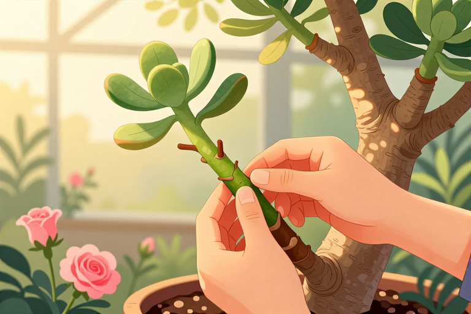

# 沙漠玫瑰怎么嫁接

想把沙漠玫瑰养出老桩的苍劲感，又渴望它开出繁复的重瓣花？单靠播种等上三五年太漫长，嫁接才是那个能让你“一夜换脸”的捷径。这株原产非洲干旱地带的夹竹桃科植物，天生带着一种粗犷的生命力，它肥厚的块根像个小酒坛，能储存大量水分以应对沙漠般的严酷环境。而嫁接，就是利用这种强健的砧木根系，去承载那些花色艳丽、形态优美的品种枝条。这不仅能让植株生长更快，还能通过改变接穗品种来丰富观赏性。当你亲手将两段生命连接在一起，看着愈伤组织慢慢愈合，那种参与生命创造的成就感，远比买一盆现成的花要来得深刻。只要掌握几个关键细节，哪怕是新手也能让嫁接苗稳稳扎根。

## 怎么挑选砧木和接穗

嫁接成功的第一步，在于选对“父母”。砧木是根基，接穗是花朵，两者性格必须合拍。对于砧木，建议选用生长健壮、无病虫害、分枝较多的3到5年生播种实生苗。这类苗根系发达，生命力旺盛，能为后续的生长提供充足的养分支持。切忌使用瘦弱或带病的植株作为砧木，否则即便接穗存活，后期也极易因为营养不足而枯萎。

接穗的选择则直接关系到你未来的观赏体验。应挑选长势良好、花色观赏性高或者重瓣品种的枝条。如果追求花量，可以选择花芽饱满的枝条；如果追求株型美观，则选取分枝点低、节间短的枝条。接穗最好处于半木质化状态，太嫩容易腐烂，太老则愈合困难。将选好的接穗剪下后，不要急着操作，先放入清水中浸泡3分钟。这一步至关重要，因为沙漠玫瑰切口流出的白色乳汁含有毒性且会阻碍愈伤组织形成，清洗掉这些汁液能大大提高嫁接成活率。

在准备过程中，还要确保所有工具经过消毒，避免引入病菌。你可以用酒精擦拭剪刀和刀片，或者在火焰上快速过一下。工具干净，伤口才能清爽地愈合。记住，嫁接不是简单的拼接，而是两个植物组织的融合，所以砧木和接穗的形成层必须紧密贴合，这是成活的关键物理基础。

## 劈接和靠接具体怎么做

嫁接手法主要有劈接和靠接两种，新手建议从劈接入手，操作相对简单直接。先将砧木上方的枝条切走，保留主干部分。用锋利的刀片在砧木切口中心垂直向下劈开一道缝，深度大约1到2厘米，宽度略小于接穗的削面。接着处理接穗，将其基部切成楔形，一面长一面短，或者两面对称，确保能顺利插入砧木的缝隙中。

- 插入接穗时，务必注意形成层的对齐。即使砧木和接穗粗细不完全一致，也要至少保证一侧的形成层（树皮与木质部之间的薄层）紧密贴合。

- 如果两者粗细相当，则最好四周都对齐，这样愈合速度最快。

- 插好后，立即用嫁接膜或保鲜膜将接口紧紧包扎起来。包扎要严密，防止空气进入导致切口干枯，同时也要防止雨水淋入引起腐烂。

靠接法则更适合对株型有更高要求的玩家。这种方法不需要切断砧木的顶部，而是在砧木和接穗的枝条上各切一个斜面，然后将两个斜面贴合在一起包扎。靠接的优点是接穗在愈合期间仍能通过自身根系获取养分，成活率极高，且后期切断连接后，植株整体结构更稳定。但缺点是操作时间较长，通常需要等待20到30天才能完全愈合，期间需要更细致的管理。

无论哪种方法，包扎后的处理都决定了最终的成败。将嫁接好的植株移到遮阳、阴凉且通风良好的地方。避免阳光直射，因为此时的伤口非常脆弱，强光会加速水分蒸发，导致接口干枯。同时，良好的通风能降低湿度过高的风险，防止病菌滋生。在接下来的10天左右，不要浇水到接口处，保持土壤微干，等待愈伤组织的形成。

## 嫁接后怎么浇水和施肥

嫁接后的水肥管理是成活的关键期，也是新手最容易犯错的地方。沙漠玫瑰本身耐旱，怕涝，嫁接后更是如此。此时根系尚未完全恢复吸收能力，过多的水分会导致切口腐烂，也就是常说的“黑杆”。因此，原则是“宁干勿湿”。

在嫁接后的前10天，基本不需要浇水，依靠植株体内储存的水分维持生命。10天后，如果接口开始愈合，可以少量浇水，但务必避开接口位置，只浇土壤表面。随着时间推移，逐渐增加浇水量。春季和秋季，每隔3到5天浇一次水即可；夏季高温时，蒸发快，可每2天浇一次，但要在清晨或傍晚进行，避免中午高温浇水造成温差冲击；冬季植株进入休眠期，落叶后应严格控制浇水，保持土壤干燥，以提高抗性，安全越冬。

施肥方面，嫁接后一个月内严禁施肥。此时伤口未愈合，肥料会烧伤切口，导致嫁接失败。一个月后，若观察到新芽开始萌发，说明嫁接成功，植株开始恢复生长。此时可以开始施加稀薄的液肥。沙漠玫瑰在生长过程中消耗的氮、磷、钾较多，生长期每月可施1次猪粪干或复合肥。同时，为了促进枝叶和根系的正常发育，避免元素缺乏症，应在幼苗期及整个生育期适量供给钙、镁、硫等元素。

此外，每隔15天左右喷一次磷酸二氢钾，能有效促进花芽分化和根系生长。但要注意浓度，宜稀不宜浓。如果发现叶片发黄或生长停滞，可能是施肥过多或过少，需及时调整。记住，沙漠玫瑰是“少吃多餐”的类型，薄肥勤施永远比一次性重肥更安全。

## 怎么判断嫁接是否成活

嫁接后最煎熬的就是等待期，如何判断接口是否愈合，新芽是否萌发？这需要你细心观察几个关键信号。首先看接穗的状态。如果接穗在嫁接后的一周内依然保持绿色、饱满，没有发皱或变黑，说明水分传输正常，这是一个好兆头。反之，如果接穗迅速变黑、干枯或发霉，那很可能是形成层未对齐或包扎不严导致感染，嫁接失败。

其次观察接口处。愈合过程中，接口周围会逐渐长出绿色的愈伤组织，这是两个植物组织融合的标志。如果接口处出现白色霉点或黑色腐烂迹象，说明湿度过大或感染了病菌，需要立即改善通风环境，严重时需重新嫁接。

- 新芽萌发是成活的最直接证据。通常在嫁接后10到15天，接穗的芽点会开始膨大，随后冒出嫩绿的新叶。此时可以轻轻扭动接穗，如果感觉稳固，不松动，说明愈合良好。

- 如果接穗长时间没有变化，甚至慢慢萎缩，可能是形成层未接触或未对齐，或者砧木活力不足。此时不要急于放弃，有时需要更长的时间才能看出结果，但超过一个月无动静基本可判定失败。

此外，还要观察砧木的反应。如果砧木出现大量落叶、茎干变软或流胶，可能是嫁接操作过重或感染病菌，影响了整体健康。此时需暂停浇水，加强通风，必要时使用多菌灵等杀菌剂进行预防性喷洒。成活后的管理同样重要，随着新叶展开，逐渐增加光照，让植株适应正常环境，但要避免烈日暴晒。

## 嫁接失败常见误区有哪些

嫁接失败往往不是因为技术太难，而是因为忽视了细节。第一个常见误区是切口汁液未清理干净。沙漠玫瑰的乳汁含有毒素和粘性物质，如果不清洗直接嫁接，会形成隔离层，阻碍愈伤组织生长。第二个误区是包扎过松或过紧。过松会导致接口干燥失水，过紧则会压迫形成层，影响养分运输。第三个误区是过早浇水。很多新手怕植物渴死，嫁接后频繁浇水，导致切口腐烂。记住，愈合期间土壤微干反而有利于愈伤组织形成。

第四个误区是光照管理不当。嫁接后立即暴晒，会加速水分蒸发，导致接穗干枯；而长期置于阴暗处，则会导致植株徒长或感染霉菌。正确的做法是放置在散射光充足、通风良好的地方。第五个误区是过早施肥。新嫁接的植株如同重病患者，急需静养，此时施肥如同给病人注射兴奋剂，只会加速死亡。

此外，季节选择也很重要。虽然沙漠玫瑰生长周期长，但最佳嫁接时间仍是春季和夏季的生长期。此时气温适宜，植物活力强，愈合速度快。冬季低温时，植物休眠，嫁接后难以愈合，极易失败。最后，心态要平和。嫁接是有概率的事件，即使技术娴熟也可能因个体差异而失败。不要因一次失败而气馁，总结经验，下次再战。

## 常见问题

### 沙漠玫瑰嫁接后多久能成活？

通常在嫁接后10到15天，接穗芽点开始膨大并萌发新叶，即视为成活。若超过一个月无变化，基本可判定失败。

### 嫁接后的沙漠玫瑰可以晒太阳吗？

刚嫁接完不能直接暴晒，需放在阴凉通风处养护10天左右。待接口愈合、新芽萌发后，再逐渐增加光照，直至正常日照。

### 沙漠玫瑰嫁接接口发黑腐烂怎么办？

这是感染病菌或湿度过大所致。需立即改善通风，剪去腐烂部分，用多菌灵处理伤口，重新包扎。严重时需重新嫁接。

### 嫁接后的沙漠玫瑰多久可以施肥？

嫁接后一个月内严禁施肥。待新芽萌发、植株恢复生长后，可每月施一次稀薄液肥，遵循薄肥勤施原则，避免烧根。

### 沙漠玫瑰嫁接用什么工具最好？

推荐使用锋利且经过消毒的专用嫁接刀或美工刀。刀具锋利能保证切口平滑，减少组织损伤；消毒则能防止病菌感染伤口。

---

原文：[沙漠玫瑰怎么嫁接](https://zlaiw.com/10704.html)
