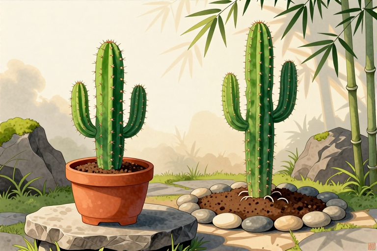

# 盆栽仙人柱和地栽区别

很多人家里养着一盆高大的仙人柱，看着它挺拔的身姿，心里难免会犯嘀咕：这玩意儿要是种在院子里，是不是长得更快、更壮实？答案其实很直接：地栽的仙人柱确实比盆栽长得更猛、开花更容易，但盆栽也有它的独特韵味和可控性。这种原产热带美洲的植物，天生就是个大个子，柱状的身材直立多分枝，有的品种能长出带棱的刺，有的则光滑无刺。它们喜欢大太阳，也耐得住干旱，但一旦离开了自然的土壤怀抱，被关进花盆这个“小房间”里，生存法则就完全变了。盆栽就像给它套了个紧箍咒，地栽则是给了它一片旷野。了解这两者的区别，不是为了比高低，而是为了让你手里的这盆绿色伙伴活得更舒展，或者让你院子里的这片风景更壮观。

## 根系空间决定生长速度

盆栽仙人柱的生长速度远慢于地栽，这是由根系受限直接导致的物理结果。在花盆里，根系的伸展范围被容器壁死死框住，土壤体积有限，养分储备就像个见底的小钱袋。当植株长到一定高度，盆土里的营养就会迅速耗尽，导致生长停滞，甚至出现“僵苗”现象。相比之下，地栽的仙人柱根系可以无限向下延伸，横向扩散范围可达数米，能汲取深层土壤的水分和矿物质。这种深根性让地栽植株拥有强大的抗逆性和持续的生长动力。在适宜的气候下，地栽仙人柱每年都能抽出新棱、长高数十厘米，而盆栽可能两三年才有一点点变化。这并非植株基因不同，而是环境赋予的资源差异。对于养花人来说，这意味着盆栽需要更频繁的干预来弥补土壤空间的不足。

如果你希望盆栽仙人柱长得快一些，核心在于“扩容”和“补给”。

- 定期换盆：每1到2年更换一次花盆，选择比原盆大一号的容器，避免一次性换太大导致积水烂根。

- 增加土壤肥力：在配土时加入缓释肥或腐熟的有机肥，为植株提供长效营养支持。

- 修剪老根：换盆时适当剪除缠绕的老根，刺激新根萌发，提高吸收效率。

## 水分管理策略截然不同

盆栽仙人柱浇水必须遵循“宁干勿湿”的原则，而地栽则几乎可以忽略日常浇水。这是因为盆栽土壤体积小，保水能力虽强但排水也快，一旦积水，根系极易缺氧腐烂。地栽仙人柱扎根深厚，土壤缓冲能力强，雨水多了能迅速渗透，干旱时深层土壤仍能提供水分。因此，盆栽仙人柱在生长期（春夏季）需要保持土壤微湿，但两次浇水之间必须让表层土壤彻底干透；冬季则需严格控水，甚至断水。地栽仙人柱在非极端干旱年份，完全依靠自然降水即可生存，无需人工干预。这种差异要求盆栽养护者具备更敏锐的观察力，通过掂量花盆重量或插入竹签检测干湿，来判断浇水时机。

避免盆栽仙人柱烂根的关键在于细节操作。

- 检查排水孔：确保花盆底部排水孔畅通无阻，必要时垫入碎瓦片或陶粒增强透气性。

- 观察叶片状态：当植株基部叶片出现轻微皱缩时，是缺水的信号，此时浇水效果最佳。

- 冬季控水：气温低于10摄氏度时，减少浇水频率，保持盆土干燥，防止低温高湿导致冻害或烂根。

## 开花条件与光照需求

盆栽仙人柱开花难度远高于地栽，这主要受限于根系空间不足和光照积累差异。仙人柱属植物通常需要长日照和充足的光热积累才能孕育花蕾。在花盆中，根系受限导致植株生长缓慢，积累的营养不足以支撑开花所需的巨大能量消耗。许多品种需要长到一定高度或年龄（如20年以上）才具备开花能力，而在盆栽环境下，达到这一标准可能需要更长时间。地栽仙人柱则因为根系发达、养分充足，加上自然环境中的昼夜温差和光照强度，更容易在成熟后开出巨大的喇叭状花朵，且花期往往更长。此外，盆栽若放置在室内或阳台角落，光照角度单一，也会导致植株徒长，进一步抑制开花。

促进盆栽仙人柱开花的具体措施包括。

- 增加光照时长：将盆栽移至朝南阳台或室外，确保每天接受至少6小时的直射阳光。

- 控制氮肥用量：生长季减少高氮肥比例，增加磷钾肥（如磷酸二氢钾）的施用，促进花芽分化。

- 制造温差：在秋季适当拉大昼夜温差，模拟自然环境，刺激植株进入生殖生长阶段。

## 越冬保温与抗寒能力

盆栽仙人柱的抗寒能力弱于地栽，冬季保温是盆栽养护的重中之重。虽然仙人柱属植物大多原产热带，但经过长期驯化，部分品种能耐受0摄氏度以上的低温。然而，盆栽土壤暴露在空气中，受气温影响剧烈，夜间温度下降快，根系容易受冻。地栽仙人柱由于土壤的热容量大，且根系深入地下温暖层，能有效抵御寒潮侵袭。在寒冷地区，地栽仙人柱通常只需覆盖薄土或枯叶即可安全越冬，而盆栽则需移入室内或温室，防止霜冻伤害。这种差异要求盆栽养护者在冬季提前规划好摆放位置，并密切关注天气预报。

盆栽仙人柱安全越冬的操作要点。

- 入室时间：在初霜来临前将盆栽移入室内，避免夜间低温直接冲击植株。

- 保持干燥：冬季保持盆土完全干燥，减少浇水，防止冷湿土壤加剧冻害。

- 光照补充：若室内光照不足，可使用植物补光灯延长光照时间，防止植株徒长变弱。

## 土壤配比与根系健康

盆栽仙人柱对土壤的透气性和排水性要求极高，而地栽则对土壤类型适应性更广。盆栽土壤必须疏松、肥沃、排水良好，通常由腐叶土、粗沙、蛭石等混合而成，以模拟原生环境的沙质土壤。若土壤过于黏重，极易导致根系窒息腐烂。地栽仙人柱则能适应多种土壤类型，只要不是长期积水的黏土或盐碱地，一般都能生长良好。地栽土壤的自然微生物群落和有机质更新，有助于维持根系健康，减少病害发生。盆栽则需定期更换土壤，防止盐分积累和病菌滋生。

配制适宜盆栽仙人柱的土壤方案。

- 基础配方：使用1/2腐叶土或泥炭土，搭配1/3粗沙或珍珠岩，以及1/6颗粒土（如赤玉土、火山石）。

- 消毒处理：新土使用前可暴晒或高温消毒，杀灭潜在病菌和虫卵。

- 定期换土：每2至3年更换一次土壤，清除老化根系，补充新鲜养分，维持土壤结构稳定。

## 常见问题

### 仙人柱多久浇一次水？

需根据季节和土壤干湿情况决定。生长期保持土壤微湿，冬季严格控水。判断标准是表层土壤完全干透后再浇水，切忌频繁少量浇水。

### 仙人柱叶子发黄怎么办？

若底部叶片轻微发黄脱落属正常新陈代谢。若大量黄叶，可能是浇水过多导致烂根或光照不足。需检查根系状态，调整浇水频率并增加光照。

### 仙人柱需要施肥吗？

需要。生长季每月施一次稀薄液肥或缓释肥，促进植株健壮。花期前增加磷钾肥比例，有助于花芽分化。冬季停止施肥。

### 仙人柱可以地栽吗？

可以。在气候温暖、排水良好的地区，仙人柱非常适合地栽。地栽植株生长更快，抗逆性强，且更容易开花，但需注意冬季防寒措施。

### 仙人柱多久换一次盆？

建议每1至2年换盆一次。当根系长满花盆或土壤板结时，应及时换盆。换盆时可修剪老根，更换新鲜疏松的土壤，促进植株生长。

---

原文：[盆栽仙人柱和地栽区别](https://zlaiw.com/10612.html)
