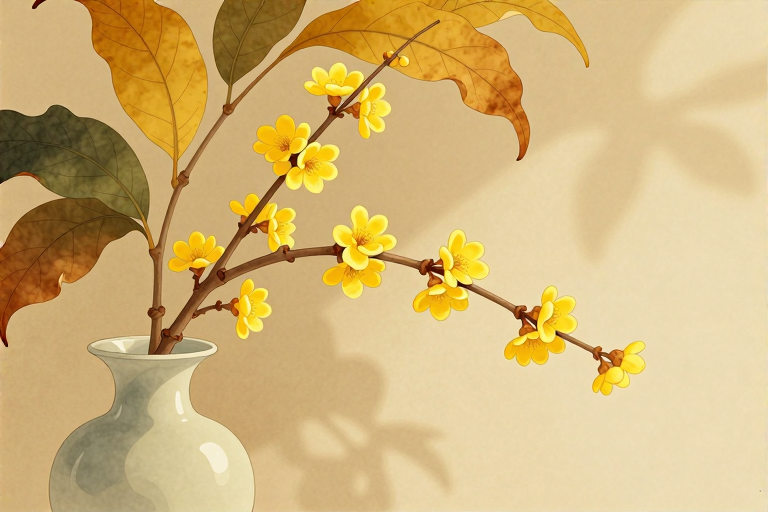

# 腊梅切枝黄叶是不是病了

腊月寒风中，一枝蜡梅横斜入画，那如蜜蜡般的花瓣透着清冷的高洁。然而，当你满怀期待地将腊梅切枝带回家，插进花瓶或移栽入盆后，没过几天，原本翠绿的叶片竟开始发黄、枯萎。面对这突如其来的“变脸”，不少人心里一紧：是不是买到了病株？还是自己养花技术太差，把花给养坏了？其实，不必惊慌，这大概率不是病害，而是腊梅在离开原生环境后，根系与叶片之间水分平衡被打破所引发的正常生理反应。

## 切枝黄叶是生病了吗

腊梅切枝后出现黄叶，绝大多数情况下并非由病菌感染引起，而是植株对环境的应激反应。腊梅属于落叶灌木，其叶片的光合作用和蒸腾作用需要根系持续吸收水分来维持。当枝条被切断，根系的吸水能力瞬间下降，而叶片仍在进行蒸腾作用，这种“入不敷出”的状态会导致叶片细胞缺水、萎缩，进而变黄脱落。

- 区分生理性黄叶与病理性黄叶：生理性黄叶通常从叶尖或叶缘开始，颜色由绿转黄最后干枯，但叶片整体结构尚好，无霉斑或虫蛀痕迹；病理性黄叶则常伴有褐色斑点、黑色腐烂或白色霉层，且发展速度极快。

- 环境突变的影响：腊梅原产于中国中部秦岭、大巴山等地，习惯生长在山地林中的微酸性沙质壤土中。从苗圃到家庭环境，光照、湿度、温度的剧烈变化会让植株感到“不适”，从而通过落叶来减少水分消耗，这是一种生存本能。

## 水浇多了还是少了

很多花友看到腊梅叶子发黄，第一反应是缺水，于是拼命浇水，结果反而加速了黄叶甚至烂根。判断浇水量的核心原则是“见干见湿”，即土壤表面干燥后再浇水，且必须浇透，但绝不能让盆底长期积水。

- 检查土壤湿度：将手指插入土中约2-3厘米，若感觉潮湿则无需浇水；若感觉干燥，则可适量补水。对于切枝水培的腊梅，需每隔1-2天更换一次清水，并清洗花瓶内壁及枝条切口，防止细菌滋生堵塞导管。

- 观察叶片状态：若叶片萎蔫下垂且土壤干燥，说明缺水，需立即补水；若叶片发黄脱落但土壤依然湿漉漉的，说明浇水过多导致根系缺氧，需停止浇水，松土通风，甚至脱盆检查根系是否腐烂。

- 环境湿度调节：腊梅喜欢湿润但不耐涝。在干燥的冬季室内，可偶尔向植株周围喷雾增加空气湿度，但避免直接喷在花朵上，以免缩短花期或引起霉变。

## 光照不足还是过强

光照是腊梅开花和维持叶片健康的关键因素。切枝后的腊梅对光照的需求较为敏感，既不能长期置于阴暗角落，也不能暴晒在强烈的直射光下。

- 适宜的光照条件：腊梅喜光，但也耐半阴。室内养护时，应将其放置在朝南或朝东的窗台边，接受明亮的散射光或柔和的直射光。每天保证4-6小时的光照即可满足其基本需求。

- 避免强光暴晒：夏季或初秋若将腊梅置于烈日下，叶片水分蒸发过快，根系来不及补充，会导致叶片迅速焦黄干枯。即使是冬季，正午时分的强光也可能对娇嫩的花瓣造成伤害，适当遮阴有助于延长花期。

- 光照不均的补救：如果室内光线不足，叶片会变薄、颜色变淡，甚至大量脱落。此时应定期转动花盆，使植株受光均匀，或移至光线更明亮的区域养护。

## 施肥时机与误区

对于切枝腊梅而言，施肥并非必需，甚至可能成为负担。腊梅本身养分储备充足，切枝后根系吸收能力弱，此时施肥极易造成“肥害”，加速黄叶和死亡。

- 水培腊梅无需施肥：如果是水插观赏，清水即可维持其数周的生命力。水中添加专用的保鲜剂或极少量的白糖（约0.1%-0.2%浓度）可延长花期，但绝非必须。

- 土培腊梅的施肥策略：若是盆栽腊梅，在生长期（春季萌芽前）可施一次稀薄的液肥，促进枝叶生长。花期前（冬季）可施磷钾肥，促使花芽分化。但一旦进入花期或叶片出现黄叶症状，应立即停止施肥，待植株恢复健康后再考虑补充营养。

- 严禁浓肥和生肥：腊梅根系较为敏感，对肥料浓度要求严格。任何未经腐熟的有机肥或高浓度的化学肥料都会烧伤根系，导致叶片迅速发黄脱落。遵循“薄肥勤施”的原则，宁淡勿浓。

## 修剪清理与通风

面对黄叶，正确的修剪和通风措施能有效防止病害蔓延，并促进植株恢复健康。盲目保留黄叶不仅影响美观，还会消耗植株养分并滋生病菌。

- 及时清理黄叶：一旦发现叶片发黄、枯萎，应立即用消毒过的剪刀将其剪除。对于切枝腊梅，可剪去部分过密或发黄的枝叶，减少水分蒸发，集中养分供给保留的叶片和花蕾。

- 改善通风条件：密闭的环境容易滋生病虫害，如红蜘蛛、介壳虫等，这些害虫吸食汁液也会导致叶片发黄。定期开窗通风，保持空气流通，是预防病害最简单有效的方法。

- 修剪病枝弱枝：对于盆栽腊梅，应剪去交叉枝、重叠枝、内向枝和病虫枝，使株型疏朗透气。修剪后伤口可涂抹愈合剂或硫磺粉，防止感染。对于切枝，定期斜剪根部1-2厘米，有助于恢复吸水能力。

## 常见问题

### 腊梅切枝水培多久换一次水？

建议每2-3天更换一次清水。换水时需清洗花瓶内壁及枝条切口处的黏液，防止细菌滋生堵塞导管，影响吸水导致黄叶。若水质清澈无异味，可适当延长至4天一次。

### 腊梅叶子发黄掉落正常吗？

切枝后少量黄叶脱落是正常的生理现象，是植株减少水分蒸发的自我保护。但若大量叶片迅速发黄脱落，则可能是浇水过多、光照不足或温度不适所致，需及时调整养护环境。

### 腊梅喜欢酸性还是碱性土壤？

腊梅偏好微酸性的沙质壤土。在北方碱性土壤地区栽培时，可定期施用硫酸亚铁溶液调节土壤酸碱度，防止因缺铁导致叶片黄化。避免长期浇水导致土壤盐碱化。

### 腊梅花期可以施肥吗？

腊梅花期一般不建议施肥。此时植株主要消耗自身储存的养分开花，施肥易造成肥害，加速花朵凋谢和叶片发黄。若需延长花期，可使用少量专用保鲜剂。

### 腊梅黄叶烂根怎么救？

发现烂根需立即脱盆，剪除腐烂根系并用多菌灵消毒，晾干后更换新土重新栽种。期间控制浇水，保持土壤微湿即可，置于通风阴凉处缓苗，待新芽萌发后再逐步恢复正常养护。

---

原文：[腊梅切枝黄叶是不是病了](https://zlaiw.com/10673.html)
