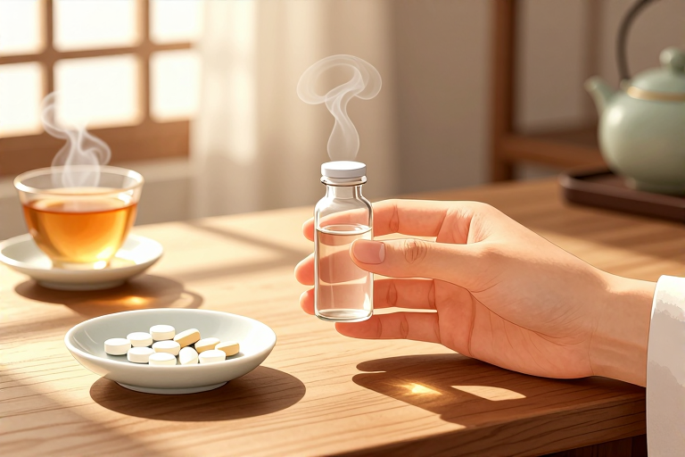

# 抗生素最多吃几天

很多人拿到药盒第一反应是问：这玩意儿到底能吃几天？是三天见效就停，还是得吃满一个疗程？答案其实并不统一，短的可能3天，长的可能要14天甚至更久。抗生素不是止痛药，吃两天觉得不疼了立马停药，往往是最危险的举动。细菌可不管你的感觉，它们只是暂时被压制，一旦你停止攻击，残留的顽固分子会迅速卷土重来，甚至进化出更强的防御力。所以，抗生素的服用时长，是由感染类型、药物半衰期以及个体差异共同决定的精密计算，而非凭感觉的随意选择。

## 普通感冒咳嗽需要吃吗

绝大多数情况下，普通感冒和病毒性咳嗽根本不需要吃抗生素。这是大众最容易踩的坑。感冒病毒在人体内有一套自己的复制逻辑，而抗生素的设计初衷是攻击细菌的结构，比如破坏细胞壁或阻断蛋白质合成。这两者就像钥匙和锁，根本不匹配。如果你因为感冒流鼻涕、喉咙痛就自己去药店买头孢或阿莫西林，不仅治不好病，反而是在给肠道菌群制造麻烦。

- 普通感冒通常由鼻病毒等引起，具有自限性，一般5到7天会自行好转。

- 抗生素对病毒无效，服用后可能出现腹泻、恶心等胃肠道反应。

- 若症状持续加重或出现黄脓痰、高烧不退，需就医排查是否合并细菌感染。

只有在医生明确诊断你合并了细菌感染，比如化脓性扁桃体炎或细菌性肺炎时，才需要启动抗生素治疗。这时候的“几天”才有意义。对于轻度的急性细菌性感染，比如单纯的尿路感染，有些短程疗法可能只需3天；而对于链球菌引起的咽炎，通常建议服用10天，以确保彻底清除细菌，防止风湿热等并发症。所以，别把抗生素当感冒药，它不是万能钥匙，用错了就是乱开火。

## 急性感染一般吃几天

对于明确诊断的急性细菌感染，比如急性支气管炎、急性中耳炎或简单的皮肤软组织感染，疗程通常在5到14天之间。这个区间看似宽泛，实则对应着不同的病情深度。医生会根据病原体的清除难度和药物在体内的代谢速度来划定这条线。太短了，细菌没杀干净，容易复发；太长了，正常菌群被误伤，导致二重感染。

- 轻度感染：如非复杂性尿路感染，部分指南推荐3天短程疗法，但需严格评估疗效。

- 中度感染：如社区获得性肺炎，通常需要7到10天的疗程，具体取决于病原体类型。

- 重度感染：如骨髓炎或心内膜炎，疗程可能长达数周甚至数月，需住院静脉给药。

这里的关键在于“足量足疗程”。很多患者有个误区，觉得吃了两天药症状明显缓解，就自行减量或停药。这是大忌。抗生素在体内的杀菌效果是随时间累积的，前两天的药物可能只是抑制了细菌的生长，真正彻底清除它们需要后续药物的持续压制。一旦提前撤军，那些生命力顽强的细菌就会趁机反扑，不仅导致病情反复，还可能筛选出耐药菌株。到时候再想治，就得换更高级、更贵、副作用更大的药，得不偿失。

## 为什么不能随意停药

擅自停用抗生素的后果，远比你想的严重。这不仅仅是“病没好透”那么简单，而是涉及微生物世界的生存法则。细菌的繁殖速度极快，在抗生素的压力下，敏感菌被杀死，但少数具有天然耐药性的变异株会存活下来。如果你此时停药，这些幸存者就获得了宝贵的“复活”机会，它们会迅速繁殖，成为优势菌群。

- 耐药性产生：残留细菌通过基因突变或水平转移获得耐药基因，下次同种药物失效。

- 病情反复：感染未彻底清除，症状暂时缓解后再次爆发，且往往更剧烈。

- 超级细菌风险：长期滥用或不当使用抗生素，可能导致多重耐药菌甚至泛耐药菌出现。

想象一下，你正在打一场仗，敌人还没投降，你就撤了兵。剩下的敌人不仅没受伤，还学会了你的武器用法。这就是为什么医生强调“吃完整个疗程”。哪怕最后一天你感觉完全好了，那最后一颗药也是为了防止细菌“诈尸”的关键。对于某些特定感染，如结核病，疗程长达6个月以上，这是因为结核杆菌代谢缓慢，且容易形成生物膜，常规剂量难以渗透，必须长时间维持血药浓度才能将其彻底清除。随意停药，前功尽弃。

## 长期服用有哪些风险

虽然抗生素是救命药，但它也是一把双刃剑。长期或频繁使用抗生素，最大的受害者其实是人体自身的微生态平衡。我们的肠道里住着数万亿个细菌，它们帮助消化、合成维生素、调节免疫。抗生素在杀灭致病菌的同时，也会无差别地攻击这些有益菌。这种“地毯式轰炸”会导致肠道菌群失调。

- 肠道菌群紊乱：可能导致腹泻、腹胀、消化不良，严重时引发艰难梭菌感染，造成伪膜性肠炎。

- 真菌感染：阴道或口腔菌群失衡，容易诱发念珠菌感染，出现瘙痒、白斑等症状。

- 肝肾负担：多数抗生素需经肝脏代谢、肾脏排泄，长期服用可能增加器官损伤风险。

此外，部分抗生素还可能影响凝血功能、神经系统或听力。例如，氨基糖苷类抗生素具有耳毒性，长期使用可能导致不可逆的听力下降；喹诺酮类药物可能与肌腱断裂风险相关。因此，除非是慢性感染需要长期抑制治疗，否则绝不应将抗生素作为日常预防手段。对于非复杂性的轻微感染，医生可能会建议观察等待，因为人体自身的免疫系统往往能搞定大部分小麻烦。给身体一点时间，比盲目用药更明智。

## 吃完药要注意什么

抗生素疗程结束，并不意味着万事大吉。停药后的护理同样重要，尤其是保护受损的肠道和监测身体反应。首先，饮食上要清淡易消化，避免辛辣刺激和油腻食物，减轻肠胃负担。其次，可以适当补充益生菌或富含膳食纤维的食物，帮助重建肠道菌群平衡。但这并非治疗手段，不能替代药物。

- 饮食调整：多吃酸奶、发酵食品或富含益生元的蔬果，辅助菌群恢复。

- 观察症状：留意是否有腹泻、皮疹、呼吸困难等迟发性过敏反应或二重感染迹象。

- 复诊评估：对于严重感染，停药后需按医嘱复诊，确认感染已彻底清除，防止隐匿性复发。

特别需要注意的是，部分抗生素在停药后仍会在体内残留一段时间。例如，服用甲硝唑期间及停药后一周内严禁饮酒，否则可能引发双硫仑样反应，导致面部潮红、头痛、呼吸困难甚至休克。此外，抗生素可能降低口服避孕药的效果，服药期间及停药后一周内建议采取备用避孕措施。了解这些细节，才能确保治疗的安全收尾，不让最后的疏忽毁了之前的努力。

抗生素的服用天数，是一场与细菌博弈的时间艺术。它既不能短到让敌人卷土重来，也不能长到伤及自身无辜。从3天的短程疗法到数月的长期抑制，每一天的设定都有据可依。面对感染，最正确的做法不是自己当医生决定吃几天，而是信任专业判断，足量足疗程，并在结束后细心呵护身体。毕竟，健康的恢复需要时间，而耐药性的产生往往只需一次侥幸。

## 常见问题

### 吃了两天药感觉好了能停吗？

绝对不能。症状缓解不代表细菌被彻底清除，擅自停药易导致病情反复或产生耐药性。必须遵医嘱吃完整个疗程，即使最后一天感觉良好也要坚持。

### 感冒发烧一定要吃抗生素吗？

不一定。普通感冒多由病毒引起，抗生素对病毒无效。只有确诊合并细菌感染，如化脓性扁桃体炎时，才需使用。滥用抗生素会破坏肠道菌群，增加耐药风险。

### 抗生素吃多了会耐药吗？

会。频繁或不当使用抗生素会筛选出耐药菌株，导致“超级细菌”出现。一旦产生耐药性，常规药物将失效，治疗难度和费用都会大幅增加，甚至无药可用。

### 吃完抗生素可以喝酒吗？

服药期间及停药后一周内严禁饮酒。特别是头孢类、甲硝唑等药物，与酒精同服可能引发双硫仑样反应，导致面部潮红、呼吸困难甚至休克，严重时可危及生命。

### 抗生素会引起腹泻吗？

有可能。抗生素在杀灭致病菌的同时也会破坏肠道正常菌群，导致菌群失调性腹泻。若出现严重水样便或腹痛，需及时就医排查是否为艰难梭菌感染，切勿自行止泻。

⚠️ 温馨提示：本文仅作健康科普，不能替代专业医生的诊断与治疗。如出现持续或加重的不适，请及时前往正规医院就医。

---

原文：[抗生素最多吃几天](https://zlaiw.com/10664.html)
