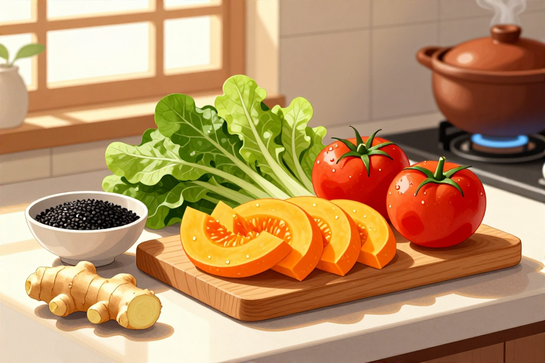

# 早泄要注意哪些饮食

提到“壮阳”，很多人脑子里蹦出的第一反应就是吃韭菜炒鸡蛋，或者啃几根生洋葱。这种民间流传甚广的“以形补形”或“特殊食材催情”的说法，听起来很有画面感，却站不住脚。早泄并非单纯的“肾虚”，而是由阴茎头敏感度过高或5-羟色胺神经递质紊乱引起的生理现象。食物进入胃部后，会被胃酸分解，其中的营养成分经过消化吸收，根本不会直接变成“壮阳药”跑到生殖器上去。真正能帮到你的，不是某一种神奇的食物，而是长期稳定的营养均衡和生活习惯调整。

## 洋葱韭菜大蒜真能壮阳吗

不能。洋葱、韭菜和大蒜常被贴上“天然伟哥”的标签，但这更多是心理安慰或营销噱头。洋葱中确实含有前列腺素，但含量极低，且人体自身就能合成前列腺素，靠吃几口洋葱来补充，就像往大海里倒一杯水，杯水车薪。韭菜富含硫化物和锌，大蒜含有蒜素，它们确实是健康的蔬菜，能抗氧化、促进血液循环，但这些作用对提升性能力的贡献微乎其微。它们的锌含量甚至不如蘑菇和白菜高。把希望寄托在多吃几盘韭菜盒子上，不如多睡半小时觉。这些食物作为日常饮食的一部分，能提供必要的维生素C和膳食纤维，让身体保持健康状态，但这与“壮阳”是两回事。如果你因为吃了这些食物而感到心理上的满足或自信提升，那这种安慰剂效应或许比食物本身更有用，但请记住，这仅仅是心理作用，并非生理上的直接改变。

## 动物内脏和海鲜怎么选

动物肾脏和生殖器官并不能补肾壮阳。很多人迷信“吃腰子补腰，吃鞭子补鞭”，这是典型的误读。动物肾脏富含蛋白质和脂肪，但也含有较高的嘌呤和胆固醇，过量食用反而增加肾脏负担和心血管疾病风险。至于动物外生殖器，虽然含有少量雄激素，但经过高温烹饪和胃酸消化后，这些激素大多被破坏，无法发挥生理作用。海鲜中的牡蛎确实富含锌，锌对精子生成和性腺健康很重要，但目前没有证据表明额外补充锌能直接提高性能力。如果你平时饮食清淡，偶尔吃点牡蛎没问题，但如果为了“壮阳”而大量进食，可能导致营养失衡。关键在于整体膳食结构，而不是单一食物的神话。保持蛋白质、维生素和矿物质的均衡摄入，比盲目进补更靠谱。

## 可乐味精是春药吗

不是。可乐加味精能壮阳的说法纯属无稽之谈。可乐的主要成分是碳酸水、甜味剂和咖啡因，味精则是谷氨酸钠。两者混合不会产生任何化学反应，更不会有“催情”效果。味精摄入过多可能导致口渴或头晕，被误认为“迷幻”，但这与性兴奋毫无关系。相反，过量摄入咖啡因可能引起焦虑和心跳加速，反而不利于放松身心。对于早泄患者来说，保持心态平和至关重要，而依赖这种毫无科学依据的“偏方”，只会增加心理负担。与其研究这些奇怪的组合，不如关注日常饮食中是否摄入了足够的B族维生素，它们对神经系统健康有益，有助于缓解紧张情绪。把精力放在健康的生活方式上，比尝试这些无效甚至有害的“秘方”更实际。

## 日常饮食该避开哪些雷区

需要避开的不是某种“禁忌食物”，而是不健康的饮食习惯。过量饮酒会抑制中枢神经系统，导致勃起功能障碍和射精控制力下降；吸烟会损伤血管内皮，影响阴茎血流供应；高糖高脂饮食则可能导致肥胖和代谢综合征，间接影响性功能。此外，过度依赖刺激性食物如麻辣火锅，可能引起前列腺充血，加重盆腔不适。建议多吃富含抗氧化剂的食物，如深色蔬菜、浆果，它们有助于保护血管健康。保持水分充足，避免脱水导致的疲劳。饮食调整的核心是“做减法”而非“做加法”，减少加工食品、减少酒精、减少糖分，增加全谷物和新鲜蔬果。这种看似平淡的饮食方式，长期来看对维持性健康远比任何偏方都有效。

## 保健品能替代正规治疗吗

不能。市面上的“壮阳保健品”往往违规添加西地那非等药物成分，虽然短期见效快，但副作用不明，可能引发严重心血管问题。早泄的治疗需要针对病因，包括心理疏导、行为训练和必要的药物治疗。饮食调理只能作为辅助手段，帮助改善整体身体状况，无法替代专业医疗干预。如果症状持续存在，影响生活质量，应及时前往正规医院就诊。医生会根据具体情况制定个性化方案，如使用局部麻醉剂或调节神经递质的药物。不要自行购买不明来源的保健品，以免延误病情或造成身体损害。记住，健康的生活方式是基础，但科学的治疗才是关键。

饮食在早泄管理中扮演的是“支持者”角色，而非“主角”。均衡营养、避免有害习惯、保持心态平和，这些日常细节的积累，比任何单一食物都更有价值。如果你正受此困扰，不妨从调整一顿健康晚餐开始，同时寻求专业医生的帮助。身体的变化需要时间，耐心与科学并重，才能找回自信。

## 常见问题

### 吃韭菜炒鸡蛋真的能壮阳吗？

不能。韭菜富含硫化物和锌，是健康蔬菜，但无法直接提升性能力。将其视为心理安慰剂更合适，真正有效的是均衡饮食和正规治疗。

### 早泄患者能不能吃海鲜？

可以适量吃。牡蛎等海鲜富含锌，对生殖健康有益，但无直接壮阳效果。需注意烹饪方式清淡，避免过量摄入导致营养失衡或消化负担。

### 喝可乐加味精有催情效果吗？

没有。这只是民间谣言，两者混合无化学反应。过量咖啡因可能引起焦虑，反而不利于放松。建议通过健康饮食和减压来改善状态。

### 动物肾脏能补肾壮阳吗？

不能。动物肾脏含高嘌呤和胆固醇，多吃增加肾脏负担。雄激素经烹饪和消化后失效。均衡摄入蛋白质和蔬菜比盲目进补更科学有效。

### 饮食调理能完全治愈早泄吗？

不能。饮食仅起辅助作用，帮助改善整体健康。早泄需针对病因治疗，如心理疏导、行为训练或药物。症状持续请就医，勿信偏方。

⚠️ 温馨提示：本文仅作健康科普，不能替代专业医生的诊断与治疗。如出现持续或加重的不适，请及时前往正规医院就医。

---

原文：[早泄要注意哪些饮食](https://zlaiw.com/10695.html)
