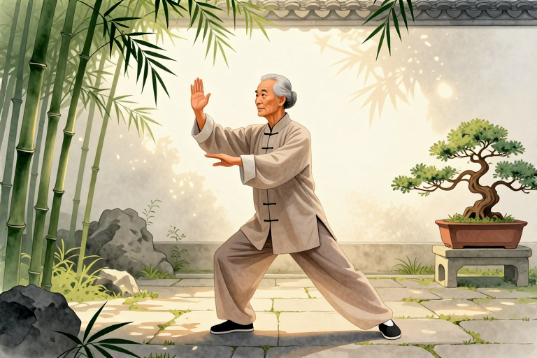

# 适合骨质疏松患者的运动

对于骨骼变得脆弱的人群来说，完全不动只会让骨头更快流失，而盲目剧烈运动又可能引发骨折。最适合的运动是那些能让骨骼承受适度压力、同时保持身体平衡的练习，比如每天散步、打太极拳或进行轻度的力量训练。这些活动能像给骨头发信号一样，告诉身体“需要更强壮”，从而延缓骨质流失，降低未来摔倒受伤的风险。

## 为什么走路对骨头好

走路是骨质疏松患者最基础也最重要的运动，因为它属于“负重”运动。当你的双脚交替着地时，身体的重量会通过骨骼传导，这种机械压力会刺激骨细胞活跃，促进钙质沉积，让骨头变得更致密。对于长期久坐或很少活动的人来说，突然开始规律行走能有效改善骨密度。

在具体做法上，不需要追求速度或里程。建议每天选择平坦的路面，以中等速度步行20到30分钟。走路时保持抬头挺胸，手臂自然摆动，步伐稳健。如果平时缺乏运动基础，可以从每次10分钟开始，逐步增加时间。关键在于“持之以恒”，每周至少坚持5天。如果走路后感到轻微疲劳是正常的，但如果出现关节疼痛或头晕，应立即停止并休息。

需要注意的是，走路虽然安全，但它对脊柱和髋部的刺激有限。如果患者已经确诊骨质疏松，或者年龄超过60岁，建议在医生评估后再开始新的运动计划。特别是有关节炎或平衡能力较差的人，可能需要借助手杖或选择更安全的室内环境进行锻炼，以防意外跌倒。

## 太极拳怎么练才安全

太极拳被誉为“动态的冥想”，它特别适合骨质疏松患者，因为它不仅能增强肌肉力量，还能显著改善平衡感。研究表明，经常练习太极拳的人摔倒风险更低，这是因为太极拳要求重心缓慢转移，训练了身体的协调性和核心肌群，让患者在日常生活中更稳当。

练习时，不必追求高难度动作，简单的“云手”或“野马分鬃”即可。关键在于动作要慢、要匀，呼吸要深长。每个动作都要感受到重心的移动，比如从一脚支撑过渡到另一脚支撑时，要刻意控制身体的稳定。建议每周练习3到4次，每次20到30分钟。最好在有经验的老师指导下学习，确保姿势正确，避免膝盖过度弯曲或扭伤。

虽然太极拳风险较低，但对于严重骨质疏松患者，某些扭转或下蹲动作可能仍具风险。如果在练习过程中感到背部不适或关节疼痛，应立即停止。此外，练习场地必须防滑、平整，穿着舒适的平底鞋。如果患者有严重的平衡障碍，建议在有人陪同的情况下进行，或者先进行简单的站立平衡训练。

## 力量训练有哪些禁忌

适度的力量训练能增加肌肉量，肌肉对骨骼的牵拉作用能进一步刺激骨形成。但骨质疏松患者的力量训练必须极其谨慎，因为错误的姿势或过重的负荷可能导致椎体压缩性骨折。核心原则是“轻重量、多次数、慢动作”，绝对避免爆发性用力。

推荐的动作包括使用弹力带进行上肢拉伸，或手持轻哑铃（如1-2公斤）进行手臂弯举。腿部练习可选择坐姿抬腿，避免深蹲或硬拉等对脊柱压力大的动作。每组动作做10到15次，做2到3组，组间休息1分钟。注意保持背部挺直，不要弓背或憋气。

禁忌动作包括：仰卧起坐、弯腰触地、举重过肩、剧烈跳跃等。这些动作会对椎体产生巨大的压缩力或剪切力，极易引发骨折。特别是仰卧起坐，会强烈弯曲脊柱，对脆弱的椎骨极为危险。如果在训练中感到任何尖锐疼痛，应立即停止并就医检查。建议在专业康复师指导下制定个性化方案，确保动作安全有效。

## 游泳对骨头有帮助吗

游泳是一项全身运动，对心肺功能和关节友好，但它对增加骨密度的作用有限。这是因为水的浮力抵消了大部分体重，骨骼缺乏必要的“负重”刺激，无法有效促进骨形成。因此，游泳更适合作为骨质疏松患者的辅助有氧运动，而非主要的治疗手段。

如果选择游泳，建议采用自由泳或仰泳，避免蝶泳，因为蝶泳对腰背压力较大。每次游20到30分钟，保持心率适中。出水后，身体会感到轻松，但要注意保暖，避免受凉引发肌肉痉挛。对于平衡能力差的患者，水中行走也是一种不错的选择，水的阻力能提供温和的肌肉训练。

需要明确的是，仅靠游泳无法预防骨质疏松。如果患者希望改善骨密度，必须结合陆地上的负重运动。此外，游泳馆的地面通常湿滑，出水时务必小心防滑。如果有皮肤破损或感染，应避免下水，以免加重病情。对于严重骨质疏松者，建议在医生指导下选择更安全的陆上运动。

## 日常活动要注意什么

除了专门运动，日常生活中的姿势管理同样重要。许多骨折发生在弯腰、提重物或转身时，因此“脊柱中立位”是关键。无论是捡东西还是穿衣，都要避免弯腰驼背，而是通过屈膝下蹲来保持背部挺直。这能减少椎体承受的压力，降低压缩性骨折的风险。

在家中进行轻度活动，如擦桌子、浇花，都是有益的。但要注意避免长时间保持一个姿势，每隔30分钟起身活动一下，促进血液循环。对于有驼背倾向的患者，可以在背后垫一个小枕头，帮助维持直立姿势。同时，家中要消除绊倒隐患，如移除地毯边缘、安装扶手等。

如果日常活动中出现不明原因的背痛，或身高明显缩短，应及时就医。不要自行按摩或强行矫正，以免加重损伤。对于已经发生骨折的患者，运动需在康复师指导下进行，避免二次伤害。保持积极心态，适度活动，比完全静止更有助于骨骼健康。

## 常见问题

### 骨质疏松症患者能跑步吗？

一般不建议。跑步属于高冲击运动，落地时的冲击力可能增加骨折风险。若必须运动，可选择快走或椭圆机，减少对脊柱和髋部的冲击。

### 每天走多少步对骨骼好？

建议每天步行20至30分钟，约6000步左右。关键在于持续性和平地行走，避免过度疲劳。如有不适，应减少强度并咨询医生。

### 骨质疏松患者能练瑜伽吗？

需谨慎选择。避免前屈、扭转等对脊柱压力大的体式。推荐阴瑜伽或修复瑜伽，强调放松和平衡。务必在专业老师指导下进行，防止受伤。

### 运动能治愈骨质疏松吗？

不能治愈，但能延缓进展。运动主要作用是刺激骨形成、增强肌肉和平衡，降低骨折风险。需结合药物、钙和维生素D补充才能有效控制病情。

### 什么情况下必须停止运动？

若出现关节剧痛、头晕、胸闷或背部突发疼痛，应立即停止。这些可能是骨折或其他严重问题的信号，需及时就医检查，切勿硬撑。

⚠️ 温馨提示：本文仅作健康科普，不能替代专业医生的诊断与治疗。如出现持续或加重的不适，请及时前往正规医院就医。

---

原文：[适合骨质疏松患者的运动](https://zlaiw.com/10603.html)
