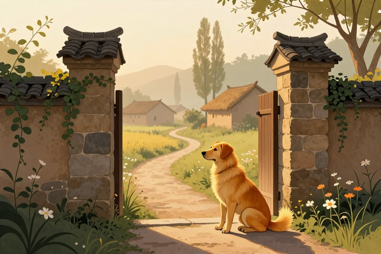

# 梦见黄狗在村口蹲着意味着什么

梦境是睡眠中的心理活动，不预示吉凶祸福，不是预兆。当你醒来时，脑海中或许还残留着那只黄狗在村口静默蹲坐的画面，那种既熟悉又疏离的感觉让人心里发毛。其实，这只“黄狗”并非来自未来的预言，而是你内心情绪的一面镜子。它可能代表了你潜意识里对忠诚与陪伴的渴望，也可能映射出你在现实生活中面对人际边界时的谨慎与防御。我们不必惊慌，只需透过这个意象，看清自己当下的心理状态。

## 黄狗在梦境中代表什么

梦见黄狗，核心指向的是“忠诚”、“守护”以及“本能”。在心理学视角下，动物往往象征着我们未被文明完全驯化的本能部分。黄色在中国传统文化语境中常与土地、中心或警示相关，而狗作为人类最早驯化的伴侣动物，其形象通常与信任、依赖和安全感挂钩。

当这只狗是黄色的，且处于“蹲着”的状态时，它传递出的信号并非攻击性，而是一种静态的张力。蹲姿是犬科动物蓄势待发的预备动作，也是休息时的警觉姿态。这可能暗示你最近在生活中，虽然表面平静，但内心处于一种“待机”状态。你可能在等待某个结果的落地，或者在观察周围环境的细微变化。这种梦境常见于那些性格敏感、重视人际关系稳定性的个体身上。它不代表你会遇到危险，而是提醒你：你的潜意识正在高度关注某些潜在的关系变动或责任归属。

从民俗文化的侧面来看，黄狗有时被视为护宅之物，但也可能象征小人或口舌是非。这种二元性恰恰反映了梦境的多义性。关键在于你梦中的情绪体验：是感到安心、好奇，还是恐惧、压抑？如果感到安心，说明你内心渴望被保护；如果感到压抑，则可能映射出你对某种束缚关系的抗拒。

## 村口这个场景有什么隐喻

梦见黄狗在村口蹲着，场景中的“村口”是理解梦境的关键。在心理学象征体系中，村庄代表你的内心世界、舒适区或熟悉的生活圈子，而“口”，即出入口，象征着边界、过渡和信息的交汇点。

村口是一个极具张力的空间。它既属于内部，又面向外部。狗蹲在这里，意味着某种力量或情绪正停留在你的心理边界上，既没有完全进入，也没有彻底离开。这可能映射出你现实生活中正处于一个过渡期，比如工作变动、居住地迁移，或是人际关系的调整阶段。你感到自己站在原地，观察着外界的变化，内心既有对未知的警惕，又有对回归平静的期待。

此外，村口也象征着“门槛”。梦见在此处蹲守的狗，可能暗示你正在面对某个决策的关口。你可能在犹豫是否要接纳新的观点、新的人，或者是否要打破某种旧有的平衡。狗的静止姿态，反映了你内心的纠结：既想保持安全距离进行观察，又担心错过重要的信息或机会。这种梦境往往出现在需要做决定，但尚未准备好行动的时刻。

## 不同情境下梦境有何差异

梦境的细节决定了其具体的心理指向。同样的黄狗蹲在村口，因互动方式和情绪感受不同，含义也截然不同。我们可以从以下几个常见情境来拆解：

- **狗看着你，但你不敢靠近：**这通常映射出你对某种权威人物或强势关系的敬畏与疏离。你可能在现实中感到被审视、被评价，从而产生防御心理。这种梦境提示你需要建立更平等的沟通方式，或者重新评估这段关系对你的影响。

- **狗对你摇尾巴或表现亲近：**这是积极的信号，象征着你潜意识里渴望得到认可、陪伴或帮助。你可能在现实中感到孤独，或正在寻求某种形式的联盟与支持。它提示你，你的内心是开放的，愿意接纳善意，只需主动迈出一步。

- **狗低声呜咽或显得焦虑：**这往往是你自身焦虑情绪的外化。那只狗就是你内心的投射，它在村口蹲守，是因为你对某些即将发生的变化感到不安。梦境在提醒你：你的紧张情绪已经溢出到潜意识层面，需要寻找合理的宣泄渠道。

- **你主动抚摸或驱赶黄狗：**主动抚摸代表接纳与整合，意味着你愿意面对内心的恐惧或需求；主动驱赶则代表排斥与否认，暗示你可能在逃避某些责任或情感问题。

## 这个梦对现实生活有何启发

理解了这个梦境，我们可以从现代心理学角度提取出几条实用的生活建议。首先，审视你当下的“边界感”。村口的狗提醒你，你是否在人际关系中设置了过高的围墙？或者是否因为害怕受伤而拒绝进入新的社交圈？适当的开放与信任，是缓解内心焦虑的关键。

其次，关注你的“待机状态”。如果最近你感到疲惫却不敢松懈，这个梦是在告诉你：休息不是罪恶，观察也不是冷漠。允许自己有一段“蹲守”的时间，去冷静评估周围的环境，比盲目行动更为重要。你可以尝试通过书写日记、冥想或与信任的朋友交谈，来梳理那些停留在心理边界上的情绪。

最后，重新定义“忠诚”与“依赖”。黄狗象征着对关系的期待。你是否在过度依赖他人的认可？或者是否对某段关系抱有不切实际的完美期待？梦境提示我们，真正的安全感来源于内心的稳定，而非外界的守护。建立自我关怀的习惯，培养独立的兴趣爱好，能帮你从这种被动的“等待”中解脱出来，获得更主动的生活掌控感。

## 如何调整因这类梦产生的焦虑

如果这个梦境让你醒来后感到不适，可以通过以下步骤进行心理调适。第一步是情绪命名，试着问自己：“如果这只狗是我的一部分，它想告诉我什么？”第二步是现实检验，列出最近生活中让你感到压力或不确定的具体事件，将模糊的恐惧具象化。第三步是行动替代，如果感到孤独，主动联系一位好友；如果感到焦虑，进行适度的运动释放多巴胺。

此外，保持规律的作息和睡前放松习惯至关重要。避免在睡前摄入过多刺激性信息，尤其是涉及冲突或恐怖的内容。可以通过阅读轻松的书籍、听舒缓的音乐来平复神经系统。记住，梦是情绪的排泄口，而非命运的判决书。当你学会与潜意识对话，这些梦境自然会变得平和而清晰。

梦见黄狗在村口蹲着，并非凶兆，而是内心世界的自然投射。它可能映射出你对忠诚关系的渴望、对人际边界的审视，或是面对变化时的谨慎心态。理解这一意象背后的心理动因，有助于我们更好地觉察情绪、调整生活状态。不妨从当下的一件小事做起，主动建立一段轻松的人际连接，或给自己一个安静的反思时刻，让内心回归平衡。

## 常见问题

### 反复梦见黄狗在村口蹲着是什么意思？

反复出现此类梦境，通常意味着你生活中的某个压力源或情感议题未被解决。潜意识在通过重复意象提醒你关注被忽略的情绪，建议深入审视近期的人际关系或生活变动，寻找根源并加以应对。

### 梦见黄狗对着我叫是凶兆吗？

并非凶兆。从心理学角度看，这更多映射出你内心的焦虑或防御机制。黄狗吠叫可能象征着你感知到的外界压力或批评声音。建议冷静分析近期是否有让你感到被指责或威胁的情境，调整心态而非迷信吉凶。

### 梦见其他颜色的狗在村口蹲着有何不同？

颜色赋予梦境不同的心理色彩。黑狗常关联未知恐惧或压抑情绪；白狗象征纯洁愿望或新开始；灰狗可能代表模糊不清的焦虑。黄狗则更侧重忠诚、警示或传统价值观的审视。具体含义需结合你个人的文化背景与情感体验。

### 梦见狗在村口蹲着却不动是怎么回事？

静止的狗象征着你内心的停滞感或等待状态。这可能反映你在现实生活中面临抉择时的犹豫不决，或对某种关系处于被动观察的态度。建议评估当前局势，明确自己的核心需求，打破心理僵局，采取主动行动。

### 做这种梦需要去烧香求平安吗？

不需要。梦境是睡眠中的心理活动，不预示吉凶祸福。烧香求平安属于民俗信仰范畴，若它能带来心理安慰尚可，但不应依赖其解决现实问题。建议从心理学角度理解梦境，关注自身情绪调节与现实问题的解决。

---

原文：[梦见黄狗在村口蹲着意味着什么](https://zlaiw.com/10625.html)
