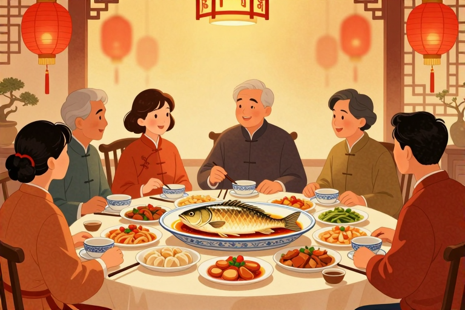

# 除夕年夜饭鱼剩头好

除夕夜的那条鱼，往往不是用来吃的，而是留在那里的。在大多数中国家庭的餐桌上，这道菜讲究“看余”，也就是只看不吃，或者只吃身子留头尾。这并非因为食材不够丰盛，也不是因为没人爱吃那部分，而是为了一个讨口彩的动作——让富足和好运从旧岁一直延续到新年。

## 年夜饭为什么要剩鱼头

年夜饭剩鱼头，核心在于“余”字的谐音。在中国传统民俗里，“鱼”与“余”同音，象征着富裕、盈余和吉祥。留鱼头或留尾，意味着“有头有尾”，也代表着“年年有余”。古人认为，除夕夜的团圆饭不仅是味蕾的享受，更是一场对未来的祈福仪式。如果鱼被吃得干干净净，那就意味着“无余”，似乎预示着新的一年可能会匮乏。因此，特意留下鱼头（有时也包括鱼尾），是将这份“有余”的状态封存起来，带进新的一年。这种心理暗示，让每一顿饭都充满了仪式感，也让人们对生活有了更多的期盼和信心。

## 南北方年夜饭鱼俗差异

虽然剩鱼头的寓意全国通用，但具体怎么剩、剩哪部分，南北方却有着微妙的差异。在南方，尤其是江南地区，鱼是年夜饭的绝对主角。这里的鱼讲究“全”，整条鱼上桌，象征着全家团圆、完整无缺。吃的时候，长辈会先动筷，夹起鱼肉，但鱼头和鱼尾必须原封不动地留在盘中，直到大年初一甚至更晚才能处理。而在北方，虽然饺子是主食，但鱼也是必不可少的。北方的鱼做法多样，红烧、清蒸皆有。剩鱼头时，往往更注重“头”的象征意义，因为“头”代表开始、领先和尊贵。有的地方讲究留鱼头给家中最尊长的老人，寓意“有头有脸”；有的地方则直接留头，表示日子过得有头绪、有条理。无论南北，这条鱼在除夕夜都超越了食物本身，成为连接过去与未来的文化纽带。

## 鱼头剩法的讲究与禁忌

剩鱼头并非随意一放，其中藏着不少老辈人传下来的规矩。首先，鱼不能翻面。在沿海或水乡地区，渔民忌讳翻鱼，因为“翻”谐音“翻船”，不吉利。所以，吃鱼时通常先吃上层肉，再剔除鱼骨，吃下层肉，绝不翻动整条鱼。其次，鱼头必须朝向特定的方向。有的地方讲究鱼头对着长辈或家主，表示尊敬；有的地方则要求鱼头朝向门口，寓意“财气进门”。再次，剩鱼的时间也有讲究。通常要留到第二天早上，甚至大年初一早上热一热再吃，这叫“吃残羹”，意味着把去年的好运吃到肚子里，或者把余粮延续下去。如果除夕夜就扔掉了鱼头，那就成了“断余”，是大忌。这些细节看似繁琐，实则是在日复一日的生活中，强化着对家庭、对传统的敬畏之心。

## 现代人如何传承剩鱼习俗

随着生活节奏加快，很多人开始质疑剩鱼头的必要性：浪费食物？不卫生？其实，传承习俗不必拘泥于形式，而应理解其内核。如今，不少家庭选择做一条小一点的鱼，或者在吃完后，将鱼头鱼尾精心打包，留作次日早餐的配菜，既避免了浪费，又保留了“有余”的寓意。还有的年轻人选择在除夕夜拍下一张完整鱼头的照片，发朋友圈祈福，用数字方式延续传统。关键在于那份对团圆的珍视和对未来的美好期许。我们可以把鱼头留给第二天给老人熬粥，或者做成香辣鱼头，让传统在现代生活中找到新的生存空间。重要的是，全家人围坐在一起，分享这道菜背后的故事，让“年年有余”的祝福在笑声中传递，这才是年夜饭真正的味道。

## 常见问题

### 除夕年夜饭的鱼必须剩头吗？

是的，通常建议剩鱼头或鱼尾。因为“鱼”谐音“余”，剩鱼头象征“有头有尾”，寓意年年有余、富足延续。

### 年夜饭剩鱼头要留到什么时候？

一般要留到第二天早上，甚至大年初一。这代表把旧年的好运和财富带到新年，叫“吃残羹”，断不可除夕夜丢弃。

### 吃年夜饭的鱼可以翻面吗？

不可以。在民俗中，“翻”谐音“翻船”，是大忌。正确做法是吃完上层肉后，剔除鱼骨，再吃下层肉，保持鱼身完整。

### 北方和南方剩鱼头习俗一样吗？

寓意相同但细节不同。南方更强调“全鱼”和“看余”，北方则更看重鱼头代表的“领先”和“尊贵”，常留头给长辈。

### 不想浪费食物还能剩鱼头吗？

可以。建议做小份量的鱼，或打包鱼头留作次日早餐熬粥、红烧。重点在于保留“有余”的象征意义，而非形式上的浪费。

---

原文：[除夕年夜饭鱼剩头好](https://zlaiw.com/10628.html)
