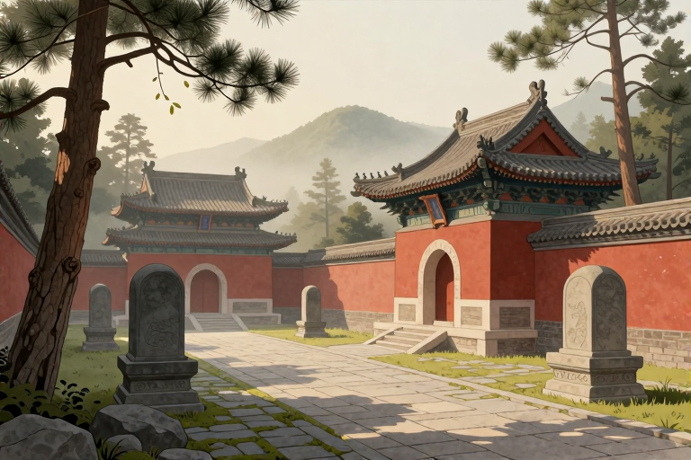

# 元明宗陵墓在哪里

如果你站在今天内蒙古高原的某处荒原上，试图寻找那位在位时间极短、年仅28岁便离世的元明宗和世㻋的陵墓，你会发现这是一次徒劳的寻找。元明宗和世㻋葬于起辇谷。这个答案听起来像是一个确切的坐标，但在历史的长河中，它更像是一团被风沙掩埋的迷雾。起辇谷并非一座孤立的坟墓，而是元朝历代大汗和皇室的家族墓地群，具体位置在今天的蒙古国肯特省境内。对于这位曾在漠北草原短暂称帝、随后又陷入兄弟权力漩涡的皇帝来说，他的归宿并不像紫禁城里的陵寝那样有着明确的碑刻和守卫，而是隐没在一片广袤而神秘的草原深处。

## 元明宗最后葬在哪里

元明宗和世㻋的确切葬地是起辇谷。根据现有的权威史料记载，他逝世后灵柩被运回，安葬于此。然而，“起辇谷”这三个字背后，藏着的是元朝皇室葬俗的特殊性以及后世考证的巨大难度。对于现代游客或历史爱好者而言，这里没有像十三陵那样清晰的导览图，也没有显赫的地面建筑。起辇谷作为元太祖成吉思汗及其后继者的葬地，其具体范围在历史上本身就存在不同的界定说法，且随着岁月流逝，地表标识早已湮灭。

要理解为什么他的陵墓难以被“找到”，我们需要回到那个马背上的时代。元朝皇室深受蒙古传统影响，讲究“密葬”。皇帝和大汗死后，遗体被运回漠北故地安葬，过程中往往采取极简甚至隐秘的手段，不立地面坟冢，不植树木标记，甚至以万马踏平地面，待草木复生后便与天地融为一体。这种葬俗旨在保护陵寝免受盗掘，却也直接导致了后世地理考证的断层。

因此，当我们谈论元明宗的陵墓时，实际上是在谈论一片区域，而非一个点。这片区域位于肯特山的南麓，靠近鄂尔浑河上游。对于和世㻋而言，他的一生充满了流亡与回归的戏剧性。他早年被迫远离权力中心，在西北边陲蛰伏多年，最终在漠北草原即位。他的死亡地点是在河北地区的王忽察都（今河北张北附近），但灵柩必须长途跋涉送回漠北祖茔。这段旅程本身就充满了政治博弈与不确定性，而最终落葬于起辇谷，则是元朝皇室礼制的必然结果，尽管具体的墓室位置至今仍是未解之谜。

## 他为何没能长眠大都

很多人会问，既然他贵为皇帝，为何不葬在元朝首都大都（今北京）附近？这涉及到元朝独特的“两都制”以及其深层的文化认同。元朝虽然定都大都，但在政治和文化心理上，漠北草原始终被视为“根本之地”。对于蒙古统治者来说，灵魂需要回归祖先的土地，这是他们统治合法性的来源之一。

和世㻋的情况更为特殊。他在位的时间极短，从1329年正月即位到八月暴卒，满打满算只有185天。在这不到半年的时间里，他刚刚经历了一场惊心动魄的权力交接。此前，他的弟弟元文宗图帖睦尔在大都称帝，但为了政治需要，曾派人迎请和世㻋，并承诺禅让。和世㻋在漠北即位后，确实接受了传国玉玺，成为正统皇帝。然而，权力的游戏从未停止。

当和世㻋南下前往与弟弟图帖睦尔会面时，他或许曾幻想过在大都享受皇家的安宁，或者至少在大都附近的皇家陵园安息。但历史没有给他这个机会。他在河北张北一带突然去世，死因成谜，有说法称是被权臣燕帖木儿毒杀。无论真相如何，他的死亡打断了所有关于身后事的规划。在这种情况下，将灵柩运回漠北祖茔，不仅是遵循祖制，更是一种政治姿态，表明他始终是“蒙古大汗”这一身份的核心继承者，而非仅仅是汉地王朝的皇帝。

此外，元朝皇室的陵墓分布并非集中在大都周边。除了起辇谷，还有其他的皇家墓地分布，但起辇谷的地位最为崇高。和世㻋作为元武宗的长子，其身份特殊，葬入这一核心区域是符合礼制的。但他未能像后来的几位皇帝那样，在汉地修建宏大的陵寝，这既是因为他在位时间太短，来不及营建，也是因为元朝中后期政治动荡，皇室精力更多集中在维持统治上，而非身后事的奢华铺张。

## 起辇谷究竟在哪

对于想要追寻元明宗踪迹的人来说，最头疼的问题莫过于：起辇谷到底在哪里？这是一个在历史地理学界争论已久的话题。简单来说，起辇谷位于今蒙古国肯特省境内，大致在肯特山脉的南麓，鄂尔浑河上游地区。这一带水草丰美，是蒙古帝国兴起的核心区域，也是成吉思汗陵寝的传统所在地。

然而，“起辇谷”并不是一个精确的经纬度坐标。在元代文献中，它指的是一片广阔的河谷地带。随着元朝皇室的繁衍，多位大汗和皇后都葬于此地。对于和世㻋而言，他的具体墓穴位置，由于缺乏地表标志和详细的考古发掘报告，至今无法确定。历史上曾有学者试图通过考证成吉思汗陵的位置来推断起辇谷的范围，但两者并不完全重合，且成吉思汗陵本身也是后世祭祀的象征性建筑，而非真正的遗骨埋藏地。

从地理环境来看，起辇谷地处高原，气候寒冷，风沙较大。这样的环境使得地面遗迹极易被自然力量抹去。千百年来，草原上的植被更替、河流改道，都可能改变地表形态。对于和世㻋的陵墓而言，它可能只是这片广袤土地上一个不起眼的土堆，或者更深埋于地下，没有任何明显的地表特征。

此外，现代政治边界的变化也给考证带来了困难。肯特省位于蒙古国东部，与我国内蒙古接壤。在历史上，这一带是游牧民族的活动中心，边界模糊。今天，我们只能在地图上找到肯特山的大致位置，却无法确定和世㻋的具体安息之处。这也使得元明宗的陵墓成为历史研究中的一个“盲点”，只有待未来的考古发现才能带来新的线索。

## 他的儿子后来葬在哪

和世㻋的儿子妥懽帖睦尔，即后来的元顺帝，是元朝最后一位皇帝。他的命运与父亲有着惊人的相似之处，但也截然不同。和世㻋暴卒后，权力重新回到弟弟图帖睦尔手中，直到图帖睦尔去世，顺帝才得以登基。顺帝在位期间，元朝政局动荡，最终被迫北逃，退出中原。

关于元顺帝的葬地，史料记载同样模糊。有说法称他死后也葬于漠北，但具体位置同样无法考证。这与元朝皇室“归葬祖茔”的传统有关。无论皇帝生前在汉地生活多久，死后灵魂仍需回归漠北。因此，和世㻋与他的儿子妥懽帖睦尔，很可能相隔不远，同葬于起辇谷的某个角落。

这种父子同葬一地的安排，体现了蒙古皇室对血缘和祖先的重视。在草原文化中，家族墓地是凝聚族群认同的重要符号。对于和世㻋而言，虽然他在位时间短暂，且死因可疑，但他作为元武宗长子、元顺帝生父的身份，决定了他必须回到这片神圣的土地。他的陵墓不仅是个人的安息之所，更是元朝皇室历史记忆的一部分。

然而，随着元朝的灭亡和北元的衰落，漠北地区的政治格局发生了巨大变化。清朝时期，为了安抚蒙古各部，曾对成吉思汗陵进行过祭祀，但其他皇陵则逐渐被遗忘。对于和世㻋的陵墓而言，它静静地躺在草原深处，见证着历史的变迁。如今，我们只能通过文献记载和有限的考古成果，去想象它曾经的模样。

## 为何找不到确切位置

你或许会好奇，既然起辇谷的范围相对明确，为什么就是找不到元明宗的具体陵墓？这背后有多重原因。首先是元朝皇室的密葬传统。如前所述，为了防盗，墓葬往往不立标记，地表平整如常。这种极致的隐秘性，使得后世难以通过地表线索进行定位。

其次是历史记录的缺失。元代史料对于皇室陵墓的具体位置记载本就简略，多使用“葬起辇谷”等笼统表述。对于和世㻋这样在位时间短、政治地位复杂的皇帝，其陵墓的细节更是鲜少被详细记录。加之元朝灭亡后，漠北地区长期处于战乱和动荡之中，许多文献资料散佚，进一步增加了考证的难度。

再者是自然环境的变迁。草原地区的生态环境脆弱，风沙侵蚀、河流改道等自然力量会迅速抹去地表痕迹。几百年过去，即使曾经有过明显的标识，也早已消失无踪。现代考古技术虽然发达，但在缺乏明确线索的情况下，大规模挖掘不仅成本高昂，而且可能破坏珍贵的地下文物。

最后，政治和历史认知的局限性也是原因之一。长期以来，学界对元朝皇室陵墓的研究重点多集中在成吉思汗等早期大汗身上，对于中后期皇帝陵墓的关注相对较少。和世㻋作为一位短暂在位、死因存疑的皇帝，其陵墓的研究价值在一定程度上被忽视。但随着历史研究的深入，未来或许会有新的发现，解开这个笼罩在草原深处的谜团。

元明宗和世㻋的陵墓位于蒙古国肯特省的起辇谷。这一答案既确切又模糊，确切在于它指明了大致区域，模糊在于它无法提供具体的坐标。对于历史爱好者而言，这或许是一种遗憾，但也正是历史的神秘之处。我们无法像参观现代陵园那样去凭吊他，但可以通过阅读史料，感受那个时代的风云变幻。如果你有机会前往蒙古国肯特省，不妨在风中驻足片刻，想象一下这片土地上曾经发生的故事。虽然看不见陵墓，但历史的回响或许就在耳边。

## 常见问题

### 元明宗和世㻋具体葬在哪个山谷？

元明宗和世㻋葬于起辇谷。这是元朝皇室的家族墓地，位于今蒙古国肯特省境内。由于实行密葬且年代久远，具体墓穴位置已不可考，仅知大致区域。

### 为什么元明宗不葬在大都附近？

元朝皇室有归葬漠北祖茔的传统，起辇谷被视为根本之地。和世㻋虽在汉地去世，但灵柩需运回漠北安葬，以符合蒙古大汗的礼制和灵魂归宿观念。

### 元明宗在位多久就去世了？

元明宗和世㻋在位时间极短，从1329年正月即位到八月暴卒，共计185天。他年仅28岁便离世，死因成谜，有说法称是被权臣燕帖木儿毒杀。

### 元明宗的儿子是谁？葬在哪里？

元明宗的长子是元顺帝妥懽帖睦尔。元顺帝死后也葬于漠北，具体位置同样不详，可能与父亲同葬于起辇谷区域，体现了元朝皇室归葬祖地的传统。

### 现在能去参观元明宗的陵墓吗？

目前无法参观具体的陵墓。因为起辇谷范围广阔且无地表标识，加上历史变迁和考古难度，具体位置不明。该区域位于蒙古国境内，游客只能了解其大致地理范围。

---

原文：[元明宗陵墓在哪里](https://zlaiw.com/10584.html)
