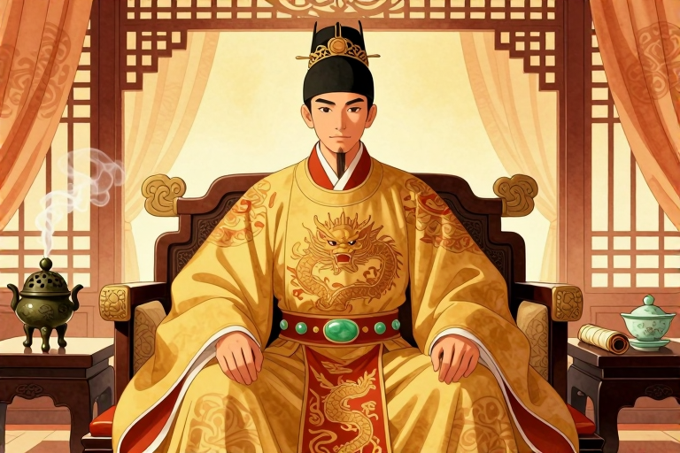

# 晋哀帝享年多少岁

东晋的皇位更迭像是一场没有终点的接力赛，而司马丕是其中跑了一段短途却极具戏剧性的选手。如果你问这位皇帝活了多少岁，答案并非模糊的“中年”或“青年”，而是精确的24周岁（传统虚岁25岁）。他生于341年，逝于365年，短短二十四载人生，前半段在等待中度过，后半段在丹药与权臣的夹缝中燃烧。他的生命刻度，不仅是个人的悲剧，更是东晋门阀政治与士人风尚交织下的一个缩影。

## 司马丕为何迟迟未登基？

司马丕的命运转折，始于他出生后的第二年。342年，他的父亲晋成帝驾崩，按照嫡长子继承制，身为皇子的司马丕本应顺理成章地接过玉玺。然而，当时掌握实权的中书令庾冰站了出来，抛出了一个看似为国为民的理由：国家正面临北方强敌的威胁，急需一位年长的君主来稳定局势，而年幼的皇子难以担当此任。

- 庾冰以“国有强敌，宜立长君”为由，阻断了司马丕的继位之路。

- 最终，晋康帝被拥立为帝，司马丕则被封为琅琊王，开始了长达近二十年的亲王生涯。

- 这一决定虽出于政治考量，却意外地让司马丕避开了幼年即位的动荡，也让他拥有了更多观察朝局的时间。

在琅琊王府的日子里，司马丕并未沉溺于享乐。他展现出了对黄老之学的浓厚兴趣，这种喜好后来成为他生命终结的关键伏笔。与此同时，东晋的政局也在暗流涌动，门阀士族之间的博弈从未停歇。司马丕作为皇室宗亲，始终处于权力的边缘，等待着那个未知的时刻。

## 361年即位背后的权力博弈

历史的齿轮在361年5月突然加速。晋穆帝病逝且无子嗣，皇统再次悬空。此时，尊为崇德太后的褚蒜子发挥了关键作用。她下诏指出，司马丕是中兴正统，且在咸康年间曾属储贰人选，如今义望情地无人能比，于是决定迎立他为帝。

- 361年5月即位，362年1月改元隆和

- 他迅速将堂兄司马奕进升为侍中、骠骑大将军，并封为琅琊王，试图通过安抚宗室来巩固统治。

- 同年9月，他立妃子王穆之为皇后，王穆之出身太原王氏，是名士王濛之女，这门联姻也折射出皇权对门阀的依赖。

即位之初，司马丕并非完全的空壳皇帝。他试图展现作为君主的威严与作为人的温情。隆和元年正月，他大赦天下并减免田税，亩收二升，显示出恢复民生、稳定社会的愿望。然而，北方的战火并未因皇位更迭而熄灭，前燕将领吕护攻陷小垒，兵临洛阳，司马丕不得不派遣庾希、邓遐等人率军救援，东晋的边防压力依然巨大。

## 庚戌土断：一次艰难的改革尝试

在位期间，司马丕推动了一项影响深远的政策——庚戌土断。这项措施旨在整顿户籍，划定州、郡、县的管辖领域，要求居民按实际居住地编定户籍。对于东晋而言，这是一个解决流民问题、增加国家赋税来源的关键举措。

- 364年3月，司马丕下令各地检阅户口，严禁隐匿人口。

- 政策执行严厉，即便是宗室成员也无法幸免。彭城王司马玄因隐匿5户被查出，随即收付廷尉，显示了皇权在改革面前的强硬姿态。

- 这一举措在短时间内取得了显著成效，大量寓客被编入所在郡县，增加了国家的控制力。

然而，庚戌土断的推行并非一帆风顺。它触动了大量门阀士族的利益，也暴露了皇权与地方豪强之间的深刻矛盾。司马丕试图通过铁腕手段来强化中央集权，但当时的东晋朝廷，早已不是那个可以一言九鼎的时代。权力的天平，正逐渐向权臣桓温倾斜。

## 服丹中毒与生命的终结

364年3月，司马丕的健康状况急转直下。他长期雅好黄老之道，断谷并服食长生药，试图追求超脱世俗的境界。然而，过量服用丹药导致他中毒，神志不清，无法处理朝政。这一事件标志着他政治生命的实质性结束，崇德太后再次临朝摄政。

- 侍中高崧曾直言劝谏，指出服食丹药并非好事，但司马丕已无法听从。

- 365年1月，皇后王穆之去世，这对司马丕是又一次打击。

- 同年2月，司马丕在西堂去世，享年约24周岁（虚岁25岁），葬于安平陵，谥号哀皇帝。

司马丕的离世，不仅是个人悲剧，也预示着东晋皇权的进一步衰落。他死后无子，皇位传给了之前的琅琊王司马奕。他的生平，像是一面镜子，映照出东晋皇室在门阀政治夹缝中的挣扎与无奈，以及那个时代士人对于长生与权力的独特执念。

## 书法成就与历史评价

除了政治生涯，司马丕在文化领域也留下了一抹亮色。他擅长书法，其作品《中书帖》被收录于中国最早的书法墨迹合集《淳化阁帖》中。这幅真迹曾在2003年被上海博物馆斥资450万美元从美国收藏家手中购回，成为珍贵的文化遗产。

- 《中书帖》展现了司马丕深厚的书法功底，风格典雅流畅。

- 这一成就证明了他不仅在政治上有所作为，在文化艺术上也有极高的造诣。

- 他的书法遗产，为后世研究东晋文化提供了宝贵的实物资料。

司马丕的一生，虽短促却充满张力。他从被搁置的皇子到短暂的皇帝，从推行改革的君主到服丹中毒的病弱者，每一个阶段都充满了历史的偶然与必然。他的故事，提醒我们历史人物并非扁平的符号，而是有着复杂情感与追求的鲜活个体。在宏大的历史叙事中，个体的命运往往如浮萍般飘摇，但他们的选择与挣扎，却构成了历史最真实的纹理。

## 常见问题

### 晋哀帝司马丕具体哪一年出生？

晋哀帝司马丕出生于341年。这一年是东晋咸康七年，他生于丹阳郡建康，籍贯为河内郡温县。这一时间点标志着他短暂而传奇的一生正式开始。

### 司马丕何时即位？

司马丕于升平五年（361年）五月即位，次年改元隆和。他生于341年，逝世于365年，享年约24周岁。

### 晋哀帝为何没有子嗣继承皇位？

晋哀帝司马丕确实有一子，生于363年9月，但早夭。史料未记载其具体名字。由于皇子早逝，他死后无子可继，最终由堂兄司马奕继承皇位，导致皇统再次转移。

### 庚戌土断政策的主要内容是什么？

庚戌土断是364年推行的户籍整顿政策。它划定州郡县领域，要求居民按实际居住地编户。此举旨在打击隐匿人口，增加国家赋税，对门阀士族利益造成冲击，执行严厉。

### 司马丕的死因是否与服丹有关？

是的，司马丕的死因与服食丹药密切相关。他雅好黄老，长期断谷服药，导致中毒神志不清，无法理政。最终于365年2月在西堂去世，享年约24周岁（虚岁25岁）。

---

原文：[晋哀帝享年多少岁](https://zlaiw.com/10707.html)
