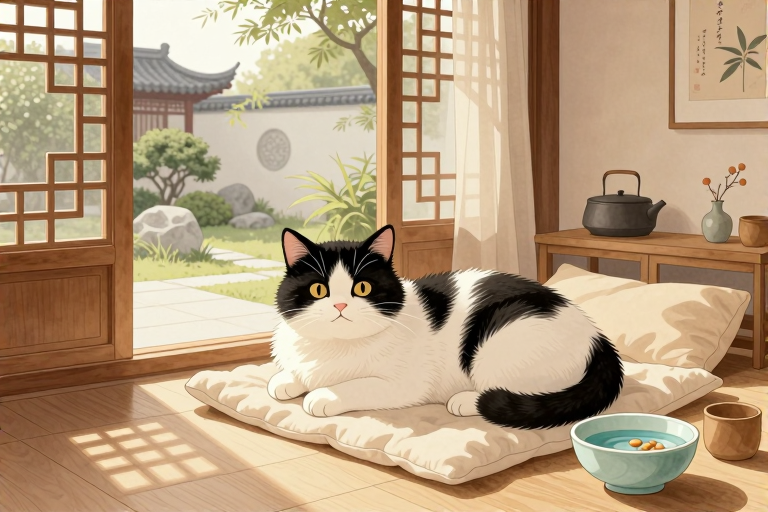

# 奶牛猫寄养一天多少钱

带着一只黑白花色的奶牛猫去寄养，很多人第一反应是问价钱，但更深层的焦虑其实是：它会不会因为换了环境而应激？毕竟奶牛猫以性格活泼、甚至有点“神经质”著称，它们对环境的敏感度远超普通猫咪。寄养一天的费用，从几十元的家庭互助到上百元的专业托管，跨度极大。这不仅仅是金钱的交换，更是你为猫咪争取到的安全感等级。选对寄养方式，比单纯比价重要得多。

## 家庭寄养一天大概多少

家庭寄养的费用通常在每天50元到80元之间，这是目前市面上性价比最高的选择之一。这种模式通常由爱猫的个人博主或资深铲屎官提供，他们会在自己家中腾出一个房间或角落专门接待寄养猫咪。对于奶牛猫来说，家庭环境相对安静，没有宠物店那种嘈杂的犬吠和无数猫叫的混合噪音，更容易让它们平静下来。

在这种模式下，你不仅能得到更细致的观察，还能获得类似“一对一”的待遇。因为主人只有这一两只寄养对象，或者最多两三只，所以每只猫得到的互动时间非常充足。你可以要求对方每天拍摄视频，甚至直播猫咪吃饭、玩耍的样子。很多奶牛猫虽然平时高冷，但在熟悉且温柔的主人面前，往往会展现出它们贪吃、粘人的一面。

选择家庭寄养时，有几个关键点需要确认：

- 确认寄养人的养宠经验，最好是有长期饲养多只猫经验的“老手”。

- 询问猫咪生病或突发状况的处理预案，是否具备基本的急救知识。

- 要求查看寄养环境的实拍视频或照片，确保通风良好、无死角。

- 明确是否包含每日清理猫砂、梳毛、陪玩等额外服务。

需要注意的是，家庭寄养依赖于个人的责任心。虽然价格低廉且温馨，但缺乏机构化的医疗支持。如果你的奶牛猫有慢性病史，或者性格极度敏感、容易应激，建议谨慎选择此类方式，或者要求寄养人具备更强的安抚技巧。

## 宠物店标准间收费多少

正规宠物店的标准化寄养，费用通常在每天80元到150元之间。这类机构提供的是标准化的笼位或房间服务，通常分为普通区、VIP区和豪华区。对于奶牛猫而言，标准间的空间相对有限，如果猫咪本身不喜欢被限制在狭小空间内，可能会产生抵触情绪。

宠物店的优势在于专业性和安全性。它们通常有24小时监控，工作人员轮班值守，能及时发现猫咪的异常行为，如拒食、呕吐或过度躲藏。此外，许多宠物店提供“猫狗分离”的区域，避免狗狗的气味和叫声刺激到敏感的奶牛猫。部分高端门店还会提供每日一次的外出放风时间，让猫咪在专用的猫房中活动。

在选择宠物店寄养时，务必关注以下细节：

- 观察店内卫生状况，特别是气味是否刺鼻，通风系统是否有效。

- 确认寄养笼位的材质和清洁频率，奶牛猫的毛发容易吸附异味，干净的笼子能减少它们的焦虑。

- 询问工作人员是否有处理应激猫的经验，以及如何安抚紧张的小动物。

- 了解是否强制收取“开饭费”或“清洁费”，避免隐形消费。

有些宠物店会将多只猫混养在同一个大笼子里，这对于领地意识强的奶牛猫来说是大忌。务必指定要求独立笼位，并提前告知店员猫咪的性格特点，以便他们采取相应的安抚措施。

## 高端别墅式寄养贵在哪

高端别墅式或酒店式寄养的费用通常在每天150元到300元甚至更高。这类服务主打的是“豪华体验”和“极致关怀”，通常配备独立的单间、猫爬架、玩具甚至摄像头实时直播。对于预算充足且对猫咪生活质量有极高要求的家长来说，这是一种选择。

这类场所的优势在于环境模拟度高。许多高端寄养中心会模仿猫咪喜欢的自然环境，设置多个休息点、躲藏处和观景窗。工作人员会按照预定时间表进行互动游戏、梳毛和清洁，甚至提供定制猫饭。奶牛猫通常精力旺盛，这种丰富的环境刺激能有效消耗它们的体力，减少因无聊而产生的拆家行为（虽然寄养期间它们无法拆家，但心理上的满足感很重要）。

然而，高价并不绝对等于高质量。在选择此类服务时，需要透过营销看本质：

- 核实工作人员的资质，是否持有宠物护理或兽医助理相关证书。

- 查看直播画面的清晰度与角度，确认是否能全方位观察猫咪状态。

- 了解突发疾病的转诊流程，是否与附近医院有绿色通道。

- 询问是否允许携带猫咪熟悉的用品，如带有主人气味的毯子或玩具。

对于奶牛猫这种性格鲜明的品种，有时候“豪华”的环境反而会让它们感到陌生和恐惧。如果猫咪本身胆小，过于花哨的环境可能不如一个安静、熟悉的小角落来得有效。

## 寄养前必须做的准备

无论选择哪种寄养方式，前期的准备工作直接决定了猫咪在寄养期间的状态。奶牛猫虽然聪明，但对变化的适应能力因人而异。提前一周开始调整它的作息，模拟寄养期间的喂食和互动时间，能减少适应期的混乱。

带上它熟悉的物品是缓解应激的关键。一块带有你气味的旧衣服、它平时最爱睡的猫窝、或者一个熟悉的玩具，都能给它在陌生环境中带来安全感。不要给它换新的猫粮，即使新粮更好吃，也要坚持使用它习惯的品牌和口味，避免肠胃不适。

在交接时，务必与寄养人进行详细的沟通：

- 提供猫咪的医疗记录，包括疫苗接种情况和既往病史。

- 详细列出它的饮食禁忌、过敏源以及平时的饮食习惯。

- 描述它的性格特点，比如是否怕生、喜欢被摸哪里、讨厌什么动作。

- 留下紧急联系人方式，并约定好每日反馈的具体时间。

如果猫咪有严重的分离焦虑或应激史，建议在寄养前咨询兽医，必要时使用费洛蒙喷雾或温和的安抚药物（需遵医嘱），以帮助它平稳度过这段时间。

## 如何判断猫咪适应良好

在寄养期间，通过视频观察猫咪的状态是了解其适应情况的最直接方式。一只适应良好的奶牛猫，虽然可能不会像在家那样粘人，但会表现出正常的探索行为：主动喝水、进食、使用猫砂盆，甚至偶尔在主人出现时发出叫声。

相反，如果猫咪长时间躲在角落里不出来，拒绝进食超过24小时，或者出现频繁舔毛导致脱毛、呕吐腹泻等症状，说明它可能处于严重的应激状态。此时需要立即与寄养方沟通，询问是否采取了额外的安抚措施，并考虑提前接回或寻求专业帮助。

观察时注意以下细节：

- 耳朵的位置：如果耳朵向后压平（飞机耳），说明它感到紧张或恐惧。

- 瞳孔状态：极度放大且长时间不收缩，可能是过度兴奋或恐惧的信号。

- 尾巴动作：快速甩动尾巴通常表示烦躁，而夹在腿下则表示害怕。

接猫回家时，不要立刻把它从笼子里抱出来。先让它在笼子里待一会儿，适应新环境的气味和声音，再慢慢打开笼门，让它自己走出来。给它一个安静的空间恢复精力，不要过度打扰。

## 常见问题

### 奶牛猫寄养期间不吃东西怎么办？

首先观察是否超过24小时。若精神尚可，可尝试更换罐头或加温食物诱导。若伴随呕吐、腹泻或精神萎靡，可能是严重应激或疾病，需立即联系兽医或接回就医。

### 寄养时猫砂盆不干净会生病吗？

是的。奶牛猫通常爱干净，长期不清理猫砂会导致泌尿系统感染或皮肤问题。选择寄养方时，务必确认其每日清理频率至少为2次，并定期消毒猫砂盆。

### 能不能给寄养的猫咪喂零食？

可以，但需谨慎。建议携带家中常吃的零食，避免新食物引起肠胃不适。喂食量要控制，以免影响正餐食欲。若猫咪有糖尿病或肾病，需严格遵医嘱禁食特定零食。

### 寄养前需要给猫咪洗澡吗？

不建议。洗澡本身就是一种强烈的应激源，尤其在寄养前夕，洗澡可能导致猫咪免疫力下降或感冒。若猫咪确实脏污，可用湿巾局部擦拭，保持清洁即可。

### 短途出差适合家庭寄养吗？

适合。对于3-5天的短途，家庭寄养能提供更温馨的陪伴。但需确保寄养人可靠，并提前测试猫咪与寄养人的互动情况。若猫咪极度怕生，建议优先选择有监控的专业宠物店。

⚠️ 温馨提示：本文仅作宠物养护科普，不能替代执业兽医的诊断与治疗。宠物如出现中毒、外伤、呼吸困难等急症，请立即送医。

---

原文：[奶牛猫寄养一天多少钱](https://zlaiw.com/10649.html)
