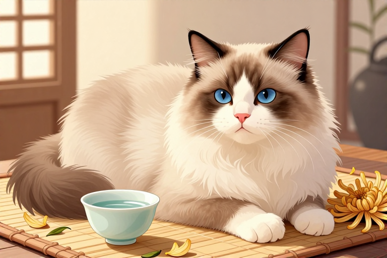

# 布偶猫真的娇气吗

很多人第一次见到布偶猫，都会被它们那副“瘫软”在怀里的模样迷住，误以为它们是需要捧在手心里怕化了、碰不得摔不得的“玻璃心”。事实恰恰相反，布偶猫不仅生命力顽强，寿命可达15到25年，更因为性格像狗一样粘人，被称为“布偶狗”。它们不娇气，只是体格大、毛发长，需要主人付出更多的时间和精力去打理和陪伴。

## 毛发打结怎么处理

布偶猫的毛发容易打结，这是它们最让人头疼但也最容易被误解为“娇气”的地方。这种半长毛质地柔软如丝，成年后体长含尾可达1米，虽然不像波斯猫那样需要每天精心梳理，但如果放任不管，打结会迅速发生。一旦毛发缠结成团，不仅影响美观，更会紧贴皮肤，导致皮肤无法透气，引发湿疹或寄生虫滋生。

家庭护理的核心在于“勤梳”而非“重梳”。建议每周至少进行2到3次的全身梳理。在梳理时，可以准备一把针梳和一把排梳。先用针梳从发根处轻轻挑开毛结，再用排梳顺毛流方向梳理到底。对于腹部、腋下等容易积毛的区域，要特别耐心。如果发现已经形成紧贴皮肤的死结，千万不要强行拉扯，那样会让猫咪疼痛并产生抵触心理，此时应使用专业剪刀小心剪除或寻求宠物美容师帮助。

- 准备合适的梳具：针梳用于开结，排梳用于顺毛。

- 梳理频率：每周至少2到3次，换毛季需增加至每天一次。

- 检查重点部位：腹部、后腿内侧、腋下是打结高发区。

- 处理死结：严禁硬拉，使用剪刀小心修剪或寻求专业帮助。

## 体重超标怎么控制

布偶猫是典型的“大个子”，成年雌性体重通常在3.6至6.8千克，雄性可达5.4至9.1千克，甚至更重。如此庞大的身躯如果缺乏运动，极易变成“煤气罐”。肥胖不仅会让它们看起来憨态可掬，更是许多健康问题的根源，尤其是关节负担过重和糖尿病风险增加。

控制体重的关键在于饮食管理和适度互动。由于布偶猫生长周期长，3到4岁才完全发育成熟，因此幼猫期和成年期的营养需求不同。选择高蛋白、适中脂肪的猫粮，避免过度喂食零食。同时，利用它们“粘人”的特性，通过逗猫棒、激光笔等玩具进行每日15到20分钟的互动游戏，既能消耗热量，又能增进感情。切忌因为觉得它们可爱就无节制地投喂，毕竟，健康的布偶猫才最迷人。

- 选择高蛋白猫粮：满足大型猫的营养需求，避免营养过剩。

- 定时定量喂食：根据猫咪体重和活动量计算每日热量，避免自助餐式喂养。

- 增加互动游戏：每天使用逗猫棒等玩具进行15到20分钟的运动。

- 定期称重监测：每月称重一次，及时发现体重异常变化。

## 肠胃敏感怎么办

布偶猫常被贴上“玻璃胃”的标签，这主要是因为它们对食物转换和饮食结构的变化比较敏感。突然更换猫粮、食用不洁食物或摄入过多脂肪，都可能导致腹泻或呕吐。这种敏感并非意味着它们只能吃昂贵的处方粮，而是提醒主人在饮食管理上需要更加细致。

应对肠胃敏感，首要原则是“稳定”。在更换猫粮时，必须采用七日换粮法，即每天逐渐增加新粮比例，减少旧粮比例，让猫咪的肠道菌群有足够时间适应。此外，避免喂食人类餐桌上的油腻食物或牛奶，这些往往是引发肠胃不适的罪魁祸首。如果猫咪出现持续腹泻或呕吐，不要自行用药，应及时咨询兽医，排除寄生虫或消化道疾病的可能。

- 换粮需循序渐进：采用七日换粮法，每天调整新旧粮比例。

- 避免人类食物：严禁喂食油腻、辛辣或含乳糖的食物。

- 观察排便情况：每日检查粪便状态，及时发现异常。

- 及时就医：持续腹泻或呕吐时，立即咨询兽医而非自行用药。

## 关节健康如何维护

布偶猫骨架大、肌肉发达，但这也意味着它们的关节承受着比小型猫更大的压力。髋关节发育不良是布偶猫常见的遗传性问题之一，虽然并非所有布偶猫都会患病，但早期预防和护理至关重要。关节问题在年轻时可能不明显，但随着年纪增长，疼痛会逐渐显现，影响猫咪的活动能力和生活质量。

维护关节健康，除了选择含有葡萄糖胺和软骨素等成分的营养补充剂外，更重要的是避免过度运动和高处跳跃。虽然布偶猫喜欢攀爬，但它们的体重使得跳跃落地时对关节冲击巨大。建议为猫咪提供稳固的猫爬架，并限制其从过高处跳下的行为。同时，保持适宜的运动量，既不能让它完全不动导致肌肉萎缩，也不能过度运动加重关节负担。

- 选择营养补充剂：适当补充葡萄糖胺和软骨素，支持关节健康。

- 限制高处跳跃：避免猫咪从沙发、床等高处以自由落体方式跳下。

- 提供稳固设施：使用稳固的猫爬架，防止因设施不稳导致的意外受伤。

- 适度运动：保持规律的运动习惯，增强肌肉力量以支撑关节。

## 性格温顺怎么引导

布偶猫的温顺是其最大的魅力，也是最容易被误解为“娇气”的原因。它们通常不记仇、不攻击人，甚至喜欢被人抱在怀里。但这种温顺并非天生完美，而是需要主人从小进行正确的社会化训练。如果缺乏引导，过度的依赖可能导致分离焦虑，或者因为不懂拒绝而受到其他宠物的欺负。

引导布偶猫的性格，关键在于“尊重”与“界限”。虽然它们喜欢被抱，但也要学会观察猫咪的情绪信号。当猫咪尾巴剧烈摆动、耳朵后压时，说明它已经不耐烦了，此时应适时放下它，让它拥有独立的空间。同时，从小让猫咪接触不同的人、环境和声音，有助于培养其自信和不怯场的性格。记住，布偶猫的温顺是建立在安全感之上的，给予它们足够的关爱和尊重，它们会以更完美的姿态回报你。

- 观察情绪信号：注意猫咪的尾巴、耳朵和眼神，及时停止不当互动。

- 提供独立空间：为猫咪准备安静的休息区，让它有独处时选择的权利。

- 社会化训练：从小让猫咪接触不同环境和人群，培养自信性格。

- 建立互动界限：明确哪些行为是可接受的，哪些是需要制止的。

## 常见问题

### 布偶猫掉毛严重吗？

布偶猫属于中等掉毛量，但因其长毛特性，掉落的毛发容易缠绕在家具或衣物上。定期梳理可以有效减少家中浮毛，换毛季时需增加梳理频率。

### 布偶猫可以吃人类剩饭吗？

绝对不可以。人类食物通常高油高盐，会加重布偶猫的肾脏负担，并引发肠胃不适。应喂食专用的宠物猫粮或兽医推荐的营养餐。

### 布偶猫多久做一次驱虫？

建议每月进行一次体外驱虫，每三个月进行一次体内驱虫。具体频率可根据猫咪的生活环境和兽医建议适当调整，保持定期驱虫至关重要。

### 布偶猫可以关笼子吗？

不建议长期关笼。布偶猫性格粘人且活跃，长期关禁闭会导致其产生分离焦虑或抑郁情绪。如需隔离，时间应控制在短时间且提供充足玩具。

### 布偶猫能和其他宠物共存吗？

布偶猫通常性格温和，能与狗或其他猫和平共处。但初次接触时需缓慢引导，观察其反应，确保双方都感到安全舒适，避免强行融合。

⚠️ 温馨提示：本文仅作宠物养护科普，不能替代执业兽医的诊断与治疗。宠物如出现中毒、外伤、呼吸困难等急症，请立即送医。

---

原文：[布偶猫真的娇气吗](https://zlaiw.com/10679.html)
