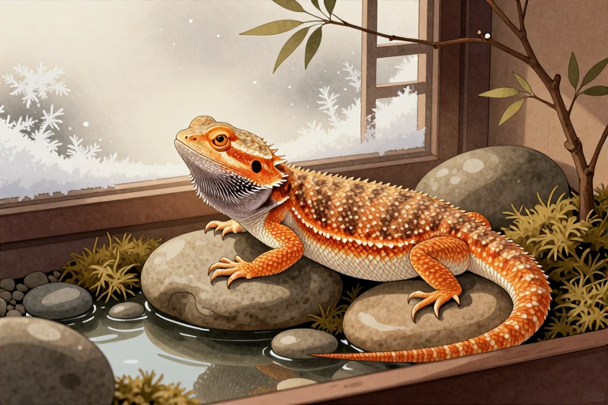

# 鬃狮蜥冬眠怎么处理

看着鬃狮蜥把自己埋在垫材里一动不动，很多新手铲屎官的第一反应往往是恐慌：它是不是病了？还是真的在冬眠？事实上，人工饲养的鬃狮蜥大多不需要也不建议进行强制冬眠，它们进入的这种状态更接近于“蛰伏”。如果处理不当，轻则导致肠胃停滞引发炎症，重则因体温过低或脱水危及生命。面对这种看似静止的生命体征，关键在于分辨这是正常的生理节律还是疾病的伪装，并用科学的手段为它提供一个安全、稳定的过渡环境。

## 怎么判断是不是真冬眠

鬃狮蜥进入蛰伏期时，身体会呈现出一种特定的“静止”状态，但这与生病导致的昏迷有着本质区别。正常的蛰伏前兆通常包括食欲明显减退直至完全停止进食，这是消化系统为了适应低温而做出的自我保护；同时，它的排泄量会大幅减少，甚至几天都不排便，这是因为新陈代谢速率随温度降低而显著放缓。观察它的体色，虽然可能会比活跃期稍显暗淡，但整体皮肤依然保持紧致，没有松弛或溃烂的迹象。如果你发现它虽然不动，但当你轻轻触碰其四肢时，它仍有微弱的收缩反应，且眼睛能够正常睁开闭合，这通常是正常的生理休眠迹象。相反，如果它长时间侧躺、头部下垂无法抬起，或者眼睛深陷、眼睑肿胀无法睁开，甚至身体出现异常的僵硬或瘫软，这极有可能是低温休克、呼吸道感染或肠胃阻塞等病理状态，此时绝不能误认为是冬眠而继续观察，必须立即采取医疗干预措施。

## 环境降温要循序渐进

如果你决定让鬃狮蜥经历自然的季节更替并进入蛰伏状态，环境的温度变化是首要考虑的因素，切忌直接将其从高温环境移入低温区域。正确的做法是在秋季开始，每周将饲养箱的加热区温度降低2-3摄氏度，同时逐步缩短光照时间，模拟自然界日照变短的过程。例如，原本每天12小时的光照可以每周减少30分钟，最终过渡到每天8-10小时的光照周期。在降温期间，饲养箱内的热点温度应保持在25-28摄氏度左右，而冷区则逐渐降至20-22摄氏度，夜间最低温度可短暂降至18-20摄氏度，但绝对不得低于15摄氏度。这种缓慢的梯度变化能让鬃狮蜥的身体机能逐步适应，避免因为温差过大导致应激反应或免疫系统崩溃。整个降温过程通常需要持续4-6周，目的是让它的肠道内容物在低温下完全排空，防止食物在体内腐败。

## 喂食与水分怎么调整

在鬃狮蜥进入蛰伏状态前及期间，饮食管理直接关系到它的生命安全。在降温开始后的第一周，如果它仍有食欲，应提供易消化的食物，如少量嫩叶蔬菜，并逐渐减少昆虫饲料的投喂量，因为昆虫难以在低温下被消化。一旦它完全停止进食，就必须立即停止任何喂食行为，哪怕它看起来只是暂时不吃，也不能强迫投喂。未消化的食物在低温环境中会迅速发酵产生气体，导致肠胃破裂或严重的肠胃炎。关于水分，蛰伏期的鬃狮蜥虽然代谢减慢，但仍需要维持体内水分平衡。建议在饲养箱内放置一个浅水盘，确保水源清洁，但不要强行给它们灌水。如果环境过于干燥，可以每周用温水轻轻擦拭它的身体1-2次，帮助其补充微量水分并防止皮肤干裂，但要注意水温不能过凉，以免引起感冒。

## 体重监控与异常应对

体重是衡量鬃狮蜥在蛰伏期间健康状况最直观的指标。在降温开始前，务必准确记录它的初始体重，并在蛰伏期间每2-3周称重一次。由于新陈代谢减慢，体重的轻微下降是正常的，但降幅不应超过初始体重的15%-20%。如果称量发现体重骤降，或者它在蛰伏后出现无法自行爬出垫材、呼吸发出哨音、鼻孔有气泡等异常表现，说明它可能出现了健康问题。此时应立即停止“自然恢复”的想法，采取保温措施，将温度缓慢回升至正常水平，并密切观察其反应。若情况没有改善，或出现脱水症状如皮肤捏起后回弹缓慢，应尽快联系异宠兽医进行补液治疗，切勿自行使用药物，因为错误的剂量对爬行动物可能是致命的。

## 醒来后如何科学复温

当春季到来，鬃狮蜥逐渐从蛰伏中苏醒时，复温过程同样需要耐心。不要突然将加热灯开到最大，这会导致它因体温急剧变化而产生应激反应。正确的复温方式是每天提高1-2摄氏度的温度，大约用一周时间将热点温度恢复到35-40摄氏度，冷区恢复到28-32摄氏度。在温度回升的过程中，它的食欲可能会在几天后恢复，此时应从易消化的食物开始尝试，如泡软的饲料或小型昆虫，并观察其排泄情况。首次排便可能颜色较深、质地较硬，这是正常现象。在完全恢复活跃状态前的一周内，避免频繁抓取把玩，给它足够的时间适应新的代谢节奏和环境刺激，确保它能健康地开启新一年的生活。

## 冬眠期间需要光照吗

在鬃狮蜥的蛰伏期间，光照的作用变得复杂且微妙。虽然它们处于静止状态，但生物钟仍然受到光周期的影响。完全黑暗的环境可能会导致它生物节律紊乱，而持续强光则会干扰其休息。因此，建议保留微弱的光照周期，可以使用低亮度的红色或蓝色夜灯，或者在白天提供自然散射光，但避免阳光直射导致局部过热。光照时间应严格遵循之前设定的缩短后的周期，如每天8小时光照加16小时黑暗。这种模拟自然昼夜交替的光照有助于维持其内分泌系统的稳定。需要注意的是，UVA和UVB灯在蛰伏期间通常建议关闭或调至最低档，因为低温下皮肤对紫外线的吸收效率极低，且长时间照射可能引起眼部损伤，待复温后再恢复正常强度的光照补充。

## 常见问题

### 鬃狮蜥一直不动是死了吗？

不一定，它可能处于蛰伏状态。若触碰四肢有微弱反应且眼睛能闭合，通常为休眠；若身体僵硬、侧躺或眼睛深陷，则可能是疾病或死亡，需立即检查体温及生命体征。

### 鬃狮蜥冬眠期间可以喂食吗？

绝对不可以。低温下消化系统停止工作，喂食会导致食物在体内腐败发酵，引发致命的肠胃炎或肠梗阻。必须等到完全复温且恢复食欲后，再逐步少量投喂易消化食物。

### 鬃狮蜥冬眠体重掉多少正常？

通常不超过初始体重的15%-20%是安全的。若降幅超过此比例，或出现脱水、呼吸异常，说明健康状况恶化，需立即停止蛰伏并进行保温及医疗干预，不可继续观察。

### 鬃狮蜥从冬眠醒来要多久恢复？

复温过程需约1周，完全恢复活跃和正常食欲可能需要2-4周。期间应提供稳定高温环境并避免频繁打扰，首次排便可能较硬，属正常现象，需密切观察其精神状态。

### 鬃狮蜥冬眠需要加湿吗？

需要适度保湿以防脱水。可在箱内放置浅水盘，或每周用温水轻擦身体1-2次补充水分。但切忌过度潮湿，以免滋生细菌导致呼吸道感染，保持垫材微干即可。

⚠️ 温馨提示：本文仅作宠物养护科普，不能替代执业兽医的诊断与治疗。宠物如出现中毒、外伤、呼吸困难等急症，请立即送医。

---

原文：[鬃狮蜥冬眠怎么处理](https://zlaiw.com/10587.html)
