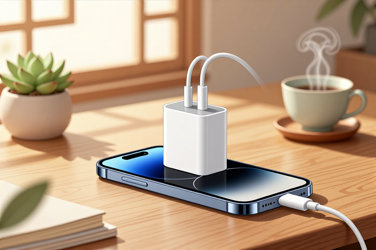

# 充电器寿命一般几年

提到充电器能用多久，很多人脑子里会蹦出一个具体的数字，比如三五年，或者更久一点。但翻阅了关于充电原理和电池特性的权威资料，你会发现这里并没有一个放之四海而皆准的“保质期”标签。充电器的寿命，本质上不是由时间流逝决定的，而是由它内部复杂的化学与物理博弈决定的。它像是一个不知疲倦的搬运工，把电网里的交流电变成设备需要的直流电，在这个过程中，热量、电压波动和电池状态都在悄悄消耗它的精力。有些充电器用了十年依然稳定，有些可能几个月就罢工，这其中的差距，不在于你买了多贵的牌子，而在于你是否读懂了它背后的运行逻辑。

## 不同电池类型对充电器的要求

充电器并不是万能的，它的“寿命”往往被它所服务的电池类型所限制。了解这一点，你就知道为什么有的充电器容易坏，有的却坚挺。资料中明确提到，不同类型的电池有着截然不同的充电需求，这直接决定了充电器的工作负荷。铅酸蓄电池、镍镉电池和锂离子电池，它们的性格天差地别，充电器也必须“看人下菜碟”。

- 对于铅酸蓄电池，尤其是汽车启动用的那种，它们能承受较高的过充电容限。这意味着简单的充电器连接恒定电压源即可，但必须在充电结束时手动断开。这种粗暴的充电方式对充电器的耐受性要求极高，因为它要承受长时间的电流冲击，一旦忘记断电，过充导致的过热会迅速摧毁充电器内部的元件。

- 镍镉和镍氢电池通常采用恒流充电，这类充电器需要精确判断充电状态，常用-ΔV或ΔT等方法检测。如果充电器无法准确识别充满时刻，持续的大电流充电会让电池发热，进而反噬充电器。特别是镍氢电池，若误充了碱性电池（外观相似），充电器缺乏电子识别程序时，可能因电压不匹配而受损。

- 锂离子电池是现代人最常用的类型，它们严禁过充。传统的锂电充电器采用先恒流后恒压的方式，当电压达到4.2V时必须切换模式，电流自然衰减至设定值后停止。这个过程需要微处理器精密控制，任何传感器失灵或电路老化导致的电压失控，都可能让充电器在瞬间过载烧毁。

所以，充电器的寿命长短，首先取决于它是否“懂”电池。专机专用的充电器，因为工作区间稳定，往往比那些试图兼容多种电池的通用充电器更耐用。而试图用简单的恒压源去充锂电池，或者用缺乏温控的充电器去充高容量镍氢电池，都是在透支它的生命。

## 温控机制决定老化速度

热量是电子元件的头号敌人，充电器的寿命在很大程度上就是它散热的能力。资料中指出，电流通过电池会产生热，大约与电流成正比。对于镍镉电池等吸热型电池，充电初期电池会冷却，充满时才停止降温开始发热；而对于锂离子电池，高充电率产生的热量必须被有效散去，否则不仅电池受损，充电器本身也会因高温而加速老化。

- 现代高端充电器内置了温度或电压感测电路以及微处理器控制器。这些元件的作用不仅仅是调节电流，更是为了在检测到异常高温时主动切断电源。如果你的充电器没有这种智能温控，或者温控传感器失效，它在长期高负荷工作时，内部电容和变压器会承受远超设计标准的温度，绝缘层加速脆化，寿命自然缩短。

- 环境温度也是隐形杀手。资料提到，高充电率的电池需要考量额外的热如何散去。在密闭的抽屉里、被衣物覆盖的插座上，或者高温的夏日车内，充电器的散热效率会大幅下降。此时，同样的电流会产生更高的温升，这种“闷热”状态会成倍加速内部电子元件的老化。

- 涓流充电器虽然电流小，但往往需要长时间连接。对于某些不允许涓流充电的电池类型（如部分锂离子电池），持续的微小电流可能导致电池微热，进而让充电器长期处于工作状态，无法“休息”。这种不间断的工作模式，会让电容等易损件提前到达疲劳极限。

想要延长充电器寿命，给它一个凉爽、通风的环境，比买更贵的充电器更有效。当摸到充电器外壳烫手时，那就是它在向你求救，此时应立即停止使用或减少负载，否则下一次可能就是彻底罢工。

## 快充技术带来的寿命挑战

随着手机和笔记本电脑对充电速度的追求，快速充电器成为了主流。资料中提到，高速充电器可以更快恢复容量，但可能比某些电池类型能容忍的更多，因此需要主动监控以防止过充。这种高强度的工作模式，对充电器的设计提出了更高要求，也带来了新的寿命变量。

- 快充的核心在于高电压或大电流。这意味着充电器内部的功率元件需要在更极端的状态下工作。普通的慢充充电器可能在10瓦的功率下轻松运行数年，但一个65瓦甚至更高的氮化镓快充头，其内部电路密度极高，能量转换过程中的热损耗也更大。长期处于高功率输出状态，相当于让一个人一直百米冲刺，体能消耗自然巨大。

- 快速充电对电池的电压稳定性要求极为苛刻。资料指出，锂电完全放电后只能以较小电流充电，充电器需先检测电压，若偏低则小电流预充，回升后再正常充电。这个检测和控制过程必须毫秒级完成。如果快充头内的采样电阻或控制芯片因长期使用出现漂移，可能导致充电策略失误，轻则充电变慢，重则损坏电池或自身电路。

- 接口处的磨损也是快充时代的通病。大功率充电往往伴随着较大的插拔力度和更频繁的接触。USB-C等接口虽然耐用，但在长期高电流通过下，金属触点的氧化和物理磨损会加速。接触不良会导致电阻增大，进而产生局部高温，这种热点效应会迅速烧毁接口附近的电路。

快充虽爽，但确实是对充电器寿命的一种“压力测试”。如果你发现快充头在充电时异常发热，或者充电速度明显下降，这往往是内部元件老化的信号，此时应警惕其继续工作的安全性。

## 如何判断充电器该退休了

既然没有固定的年限，我们该如何知道手中的充电器是否还能继续服役？资料中提到的关键风险点，如过热、无法切断充电、电压失控等，其实就是充电器发出的“退役信号”。关注这些物理征兆，比纠结于用了几年更靠谱。

- 观察外观与气味。如果充电器外壳出现变形、变色，或者闻到焦糊味，这是内部绝缘材料或元件过热的直接证据。此时必须立即停用，因为它已经失去了安全保护能力，继续使用的风险远大于更换成本。

- 感受温度变化。正常的充电器在充电时会温热，但不应烫手。如果在一个通风良好的环境中，充电器依然异常发烫，或者在相同负载下比以前更热，说明其散热效率下降或内部元件效率降低，寿命已近尾声。

- 检查充电稳定性。对于带有指示灯的充电器，如果指示灯闪烁不定，或者充电过程中设备频繁断开连接，这通常意味着内部电容容量衰减或控制电路不稳定。对于铅酸电池充电器，如果无法在充满后自动或手动有效切断，导致电池过充，那么这个充电器就已经失去了核心价值。

- 留意接口松动。充电接口的物理磨损会导致接触电阻变大，引发打火或高温。如果插头插入后轻微晃动就断电，或者需要特定角度才能充电，说明接口已严重磨损，建议更换。

充电器的寿命是一场与热量和时间的博弈。它没有统一的保质期，只有状态的好坏。当它开始发热失控、充电不稳或外观破损时，就是它功成身退的时候。不要为了省几十块钱而让一个老化的充电器继续工作，毕竟，保护你的电池和设备，才是它最后的使命。

## 常见问题

### 充电器发热严重还能继续用吗？

不能。资料指出电流通过电池会产生热，若充电过程导致异常高温，说明散热失效或元件老化。继续使用可能导致过热燃烧或爆炸风险，应立即停止使用并更换。

### 镍氢电池可以用快充充电器吗？

需谨慎。镍镉和镍氢电池通常采用恒流充电，需精确检测充满状态。若快充充电器缺乏针对此类电池的温控或截止功能，可能导致过充、发热甚至损坏电池，建议选用专用充电器。

### 锂电池可以一直插着涓流充电吗？

不可以。资料明确提到锂离子电池使用化学系统，不允许无限涓流充电。长期连接可能导致电池容量减少、寿命缩短或过热损坏，应在充满后及时断开或确保充电器有自动切断功能。

### 充电器接口松动了怎么办？

建议更换。接口松动会导致接触电阻增大，在大电流充电时易产生局部高温，加速老化甚至引发火灾。资料未提及维修接口的方法，出于安全考虑，直接更换是最佳选择。

### 如何延长充电器的使用寿命？

关键在于控制温度和匹配电池类型。确保充电器通风良好，避免在高温环境使用；根据电池类型（如锂电、铅酸）选用具备相应保护机制的充电器，避免过充或误充，从而减少内部元件损耗。

---

原文：[充电器寿命一般几年](https://zlaiw.com/10692.html)
