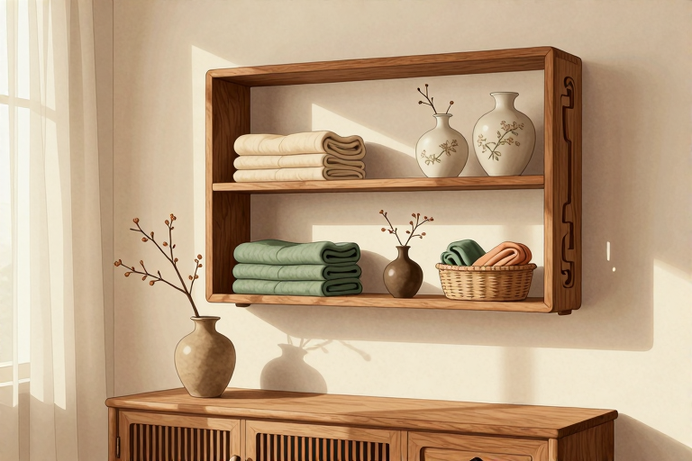

# 墙面挂架怎么分类放

把家里乱成一团的杂物，靠一面墙就理顺，关键不在于买多贵的架子，而在于搞清楚“谁该待在哪”。很多人装修时只顾着打孔安装，结果挂满东西后依然找不到顺手的地方，甚至因为受力不均导致墙面脱落。其实，墙面收纳是有物理逻辑的：黄金视线区放最常用的，腰部以下放最重的，高处放最轻的。只要把这4个区域的分发逻辑理清楚，哪怕只是几根挂钩和一块隔板，也能让原本拥挤的角落变得井井有条。

## 玄关挂架怎么分区收纳

玄关挂架的核心原则是“动线最短”，把每天出门必带的物品放在伸手可及的1.5米高度区间。这里不是展示区，而是功能区的延伸，如果挂得太高或太低，都会增加你出门前的心理负担，导致钥匙、口罩随手乱扔。合理的玄关收纳应该遵循“外穿内收、重下轻上”的原则，让鞋子、包袋和零碎小物各归其位。

- 准备一套可调节的挂钩组和一个底部带鞋托的挂架。选择挂钩时，留意承重标称值，普通塑料挂钩通常只能承受1-2公斤，金属挂钩则能轻松应对厚重的冬装外套。

- 在挂架的最上层，安装3-4个S型挂钩，专门悬挂轻便的帆布袋、环保购物袋或折叠伞。这些物品使用频率高但重量轻，放在高处既不占空间，拿取时也不需要弯腰。

- 在视线平行的高度（约1.6米），安装2-3个强力粘钩或螺丝挂钩，用于挂钥匙盘、工牌绳和常备的口罩。这个高度符合人体自然垂手的动作轨迹，形成肌肉记忆，出门时顺手一拿，进门时顺手一挂。

- 在挂架的下部，设置一个落地的鞋托或低矮的挂钩区，专门放置常穿的拖鞋、雨靴或运动水壶。重物下沉是物理常识，这样既能保证挂架整体的稳定性，又避免了弯腰过深带来的不适感。

- 注意区分“季节性”与“日常性”。冬季厚重的大衣不要长期挂在玄关，以免挤压变形，应定期轮换或移至衣柜深处。玄关只留当季最可能穿的那一件。

- 避免在玄关挂架下方堆放杂物。留出至少30厘米的地面空间，方便鞋子进出，也防止灰尘堆积在鞋面上，影响二次使用的心情。

## 厨房墙面怎么利用挂钩

厨房墙面的收纳逻辑是“台面清零”，把那些细碎、高频使用的工具全部上墙。厨房台面是最难保持整洁的地方，因为做饭过程中产生的调料瓶、刀具、铲子无处安放。通过垂直空间的利用，不仅能释放出宝贵的切菜面积，还能让烹饪流程更加流畅，避免在柜子里翻找工具的尴尬。

- 选购免打孔的纳米胶挂钩或不锈钢挂杆。厨房环境潮湿且有油烟，普通胶条容易失效，纳米胶的附着力更强，且拆除时不易留痕。挂杆则能提供更多元的挂载点。

- 在灶台侧面的墙面上，安装一根伸缩挂杆或固定铁艺架，用于悬挂最常用的锅铲、汤勺和漏网。这些工具在炒菜时几乎每30秒就要使用一次，放在触手可及的地方能极大提升烹饪效率。

- 在备菜区上方的墙面，安装一块免打孔的置物板或磁吸刀架。将常用的刀具吸附在磁吸条上，既安全又卫生；小瓶装的盐、胡椒、鸡精可以统一摆放在置物板上，标签朝外，一目了然。

- 利用门后或柜侧的缝隙，粘贴一排S型挂钩，悬挂保鲜膜、厨房纸或洗碗海绵。这些地方往往被忽略，却是收纳细小物品的绝佳空间，能有效减少台面杂乱。

- 严禁在燃气灶正上方悬挂易燃物品。高温会加速挂钩老化，甚至引发火灾风险。所有挂架的安装位置必须远离火源至少50厘米。

- 定期清洁挂钩和挂杆上的油渍。油污积累不仅影响美观，还会降低粘胶的附着力。每月用温水擦拭一次，能延长挂架的使用寿命。

## 卫生间墙面如何防潮收纳

卫生间墙面的收纳难点在于“潮湿”与“腐蚀”，因此必须选择耐腐蚀材料并遵循“干湿分离”的原则。卫生间里的毛巾、牙刷、洗发水等物品，如果随意堆放，不仅容易滋生细菌，还会因为水汽侵蚀而快速损坏。通过合理的分区，可以让每一件物品都处于适宜的环境中，延长使用寿命。

- 在淋浴区外侧的干燥墙面，安装不锈钢或太空铝材质的置物架。避免使用铁质镀层挂钩，因为这些材料在潮湿环境中极易生锈，锈迹会污染毛巾和衣物。不锈钢材质耐腐蚀、易清洁，是卫生间收纳的首选。

- 在洗手台旁的墙面，安装一个带沥水功能的牙刷杯架和牙膏置物架。将牙刷头朝上放置，避免积水滋生细菌。牙膏、洗面奶等管状物品可以直立摆放，节省空间且方便取用。

- 在马桶上方的墙面，安装一个窄长的置物架，用于放置卷纸、清洁刷或香薰。这个位置通常光线较暗，但空间利用率高，适合存放不常使用但需要触手可及的物品。

- 对于洗澡用的毛巾，建议悬挂在通风良好的位置，而不是直接搭在浴缸边缘或洗手台上。可以使用专门的毛巾环或挂钩，确保毛巾能够完全展开，加速干燥，防止霉味产生。

- 不要将重物挂在轻质石膏板墙面上。如果墙体内部没有龙骨支撑，重型置物架可能会导致墙面开裂脱落。安装前务必确认墙体材质，必要时使用膨胀螺丝加固。

- 避免在淋浴区内直接安装粘胶挂钩。高温蒸汽会加速胶层老化，导致挂钩脱落。淋浴区的收纳应依靠墙角三角篮或吸盘式置物架，并定期检查吸盘的密封性。

## 客厅墙面怎么兼顾美观与实用

客厅墙面的收纳核心是“藏露得当”，既要展示生活情趣，又要隐藏杂乱无章。客厅是家庭的核心活动区，墙面不仅是视觉焦点，也是功能延伸。过于裸露的收纳会让空间显得拥挤，而完全封闭则失去了生活的烟火气。通过巧妙的分类，可以在美观与实用之间找到平衡。

- 在电视背景墙两侧，安装对称的薄款置物架或开放格。这些架子适合摆放书籍、相框、绿植或收藏品。高度控制在视线平视或略高处，避免低头取物带来的疲劳感。

- 在沙发旁的墙面，安装一个简约的挂画式收纳架或洞洞板。洞洞板具有极高的灵活性，可以通过更换配件来挂载耳机、遥控器、便签等小物。这种设计既现代又实用，能随时根据需求调整布局。

- 在玄关与客厅的过渡区，设置一个换鞋凳上方的挂钩区。这里可以悬挂出门常穿的外套、包包或婴儿推车。选择与家居风格协调的挂钩，如黄铜色或哑光黑色，提升整体质感。

- 利用墙角空间，安装一个落地式衣帽架或折叠挂衣架。在不占用日常活动空间的前提下，为临时悬挂衣物或待洗衣物提供场所，避免衣物堆积在椅子上形成“懒人山”。

- 注意挂钩的间距与物品的宽度匹配。如果挂钩间距过窄，悬挂的物品容易相互挤压，导致变形或难以取用。一般建议每个挂钩之间保留15-20厘米的空间。

- 定期整理墙面挂载物。每季度检查一次挂架上的物品，清理不再需要的杂物，更换损坏的挂钩。保持墙面的整洁，也是保持心情的清爽。

## 常见问题

### 免打孔挂钩粘不牢固怎么办？

先用酒精擦拭墙面和挂钩背面，确保无油无灰。粘贴后用力按压30秒，并等待24小时再挂载重物。若墙面粗糙，可改用膨胀螺丝固定。

### 厨房挂架上的油污怎么清洗？

将小苏打与热水混合成糊状，涂抹在油污处静置10分钟，再用湿布擦拭。对于顽固油渍，可用专用厨房清洁剂喷洒，最后用清水擦净即可。

### 卫生间挂钩生锈了怎么处理？

立即取下生锈的挂钩，用钢丝球或砂纸打磨掉锈迹。若锈蚀严重建议更换为不锈钢或塑料材质。新挂钩安装前，可在接触面涂一层透明指甲油防锈。

### 洞洞板配件不够用怎么扩展？

洞洞板的魅力在于其模块化设计。你可以单独购买挂钩、篮子或托盘等配件进行补充。根据物品形状选择不同尺寸的配件，灵活组合即可满足新需求。

### 墙面挂架安装需要打孔吗？

取决于墙体类型和挂架重量。轻质物品可用免钉胶或纳米胶；重型物品如电视架、大置物架必须使用膨胀螺丝打入墙体内部，以确保安全稳固。

---

原文：[墙面挂架怎么分类放](https://zlaiw.com/10600.html)
