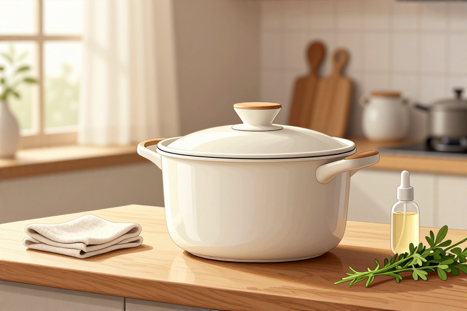

# 多功能锅怎么保养更耐用

一台大同电锅能陪人走多久？很多台湾家庭的答案是“从祖母传到孙辈”。它没有复杂的芯片，也没有娇贵的触摸屏，靠的是最朴素的物理原理：外锅加水，内锅放米，水干自动跳起。这种机械式的简单，恰恰是它长寿的秘密。但再耐用的机器，也怕错误的保养方式。很多人发现电锅用久了煮饭夹生、外壳发黄，甚至电源线老化漏电，其实都是日常习惯惹的祸。保养电锅，不是要把它供起来，而是要懂它的脾气。

## 内锅底发黑怎么清理

内锅底部发黑或结垢，不仅影响美观，更会阻碍热传导，导致煮饭时间变长、耗电增加，甚至烧焦内锅。清理的核心在于“软化”和“温和摩擦”，切忌用钢丝球硬刷，那样会破坏内锅表面的保护层，加速腐蚀。

- 准备半杯白醋或柠檬汁，加入适量清水，倒入内锅中。水量需覆盖发黑区域，通常约200毫升即可。

- 将内锅放入外锅，加入清水至外锅刻度线“1”以下。接通电源，启动煮饭开关。

- 待水沸腾后，继续煮约10到15分钟。酸性物质会与底部的碱性水垢或食物残渣发生反应，使其松动脱落。

- 断电后，待水温稍凉，用海绵或软布轻轻擦拭内锅底部。顽固污渍可用纳米海绵蘸取少量牙膏轻擦。

- 用清水冲洗干净，并用干布擦干内外壁，再放回原处。

## 外锅积水如何正确处理

外锅是电锅的“底座”，负责容纳加热盘和传导热量。如果外锅内残留积水，不仅会导致加热效率降低，更可能腐蚀底部的电气元件，引发短路或漏电风险。每次使用后，外锅必须保持干燥。

- 煮饭结束后，先拔掉电源插头，等待电锅自然冷却至室温。切勿在通电状态下移动或清洗。

- 用干抹布或厨房纸巾，彻底擦干外锅内部的积水。特别注意加热盘周围和底部角落，这些地方容易积聚水滴。

- 如果外锅外侧有油污或污渍，可用湿布蘸取少量中性清洁剂擦拭，再用干布擦干。避免使用强酸强碱清洁剂，以免损伤外壳涂层。

- 长期不使用时，建议将内锅取出单独存放，外锅倒置放置，以确保内部空气流通，防止潮湿发霉。

## 电源线老化怎么应对

在众多用户口中，电锅最易损的零件往往是电源线。由于经常插拔、弯折，加上厨房环境的温热湿气，电源线外皮容易硬化、开裂，甚至露出铜线。这不仅影响美观，更存在严重的安全隐患。

- 定期检查电源线外观，特别是插头连接处和弯折部位。若发现外皮破损、硬化或闻到焦糊味，立即停止使用。

- 切勿自行修补电源线。老旧电锅的插头规格可能较为特殊，且内部线径需匹配功率要求，随意更换可能导致接触不良或过热。

- 联系官方售后或正规维修点，购买原厂规格的电源线进行更换。原厂配件在材质阻燃性和导电性上更有保障。

- 日常收纳时，避免将电源线紧紧缠绕在电锅机身周围。应松散卷曲存放，减少内部铜丝因反复弯折而疲劳断裂的风险。

## 煮不同食材水量怎么控

大同电锅的多功能性源于其稳定的蒸汽循环。但很多人误以为所有食材都按同一比例加水，结果导致稀饭溢锅、米饭夹生或炖品过稀。掌握“水量决定时间”的原理，是保养电锅、提升烹饪效果的关键。

- 煮白饭：遵循内锅刻度线。一般1杯米加200毫升水，对应外锅“1”刻度。水量过多会导致米饭软烂，过少则夹生，且可能因干烧损坏加热盘。

- 煮稀饭：需大幅增加外锅水量。通常需加水至外锅“3”或“4”刻度以上，以提供足够的蒸发量。同时，米饭用量不宜过多，以免溢出。

- 蒸馒头或卤肉：利用内锅架配件。在外锅加水至合适高度（通常没过内锅底部即可），将盛放食材的内锅置于架上。蒸汽循环能均匀加热，无需额外加水至食材中。

- 炖中药：注意药材吸水性。若药材干燥，需适当增加外锅水量。同时，避免使用金属勺搅拌，以免刮伤内锅涂层。

## 长期闲置怎么存放

电锅并非一次性用品，许多家庭会因搬家、更换厨房或长期出差而闲置电锅。错误的存放方式会导致内部元件受潮、线路老化加速，甚至滋生细菌。正确的收纳能延长其“休眠期”的寿命。

- 彻底清洁并干燥：存放前，务必按前述方法清洗内外锅，并确保完全干燥。任何残留的水分都可能在密闭空间内滋生霉菌。

- 取出内锅：将内锅从外锅中取出，单独存放在干燥处。避免内锅长期置于外锅内，造成底部受热不均或压迫加热盘。

- 覆盖防尘罩：用干净的棉布或专用防尘罩覆盖电锅机身，防止灰尘进入散热孔或控制面板缝隙。切勿使用塑料布紧紧包裹，以免不透气导致冷凝水产生。

- 定期检查：即使闲置，建议每半年检查一次电源线和机身状况。若发现异味或虫蛀痕迹，需重新清洁并通风晾干后再存放。

## 常见问题

### 内锅涂层脱落还能继续用吗？

不建议继续使用。涂层脱落可能导致食物粘连，且裸露的金属基材在高温高湿环境下易生锈，有害物质可能渗入食物。若涂层严重剥落，为健康着想，应更换新内锅或整机。

### 煮饭时溢锅了怎么处理？

立即断电，待冷却后清理外锅积水。检查内锅是否变形，若有变形需更换，否则影响密封性。清洁时注意不要损坏加热盘表面的感应触点，可用软布蘸酒精轻擦。

### 电锅煮饭夹生怎么办？

可能是水量不足或内锅底部有污垢阻碍热传导。先检查外锅水位是否达标，再清洁内锅底部。若排除这两点，可能是加热盘老化或机械开关故障，需送修检测。

### 电源线插头松动怎么修？

切勿自行拆解插头。插头松动可能导致接触电阻增大，引发过热甚至火灾。请联系厂家售后更换原厂插头或整条电源线。临时应急可使用合格的大功率转换插头，但需专人看护。

### 电锅外壳发黄怎么恢复？

外壳发黄多为塑料老化或油污沉积。可用小苏打粉加水调成糊状，涂抹在发黄处静置10分钟后轻擦。避免使用强效漂白剂，以免腐蚀涂层。若为不可逆老化，则无法完全恢复。

---

原文：[多功能锅怎么保养更耐用](https://zlaiw.com/10631.html)
