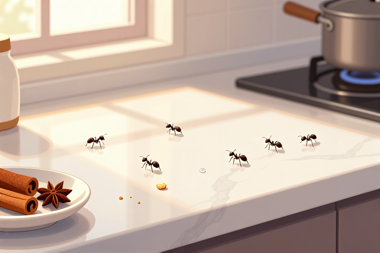

# 蚂蚁爬灶台怎么办

灶台上突然出现的黑色小点，往往不是灰尘，而是正在“巡视”领地的蚂蚁。它们并非故意捣乱，只是被食物香气或缝隙里的潮湿吸引。对付这群忙碌的入侵者，靠拍打只能解一时之快，真正的解决之道在于理解它们的习性并切断补给线。只要找准源头，用对方法，就能让灶台恢复清爽。

## 灶台有蚂蚁怎么快速驱赶

面对刚爬上灶台的零星蚂蚁，最忌讳的是直接喷洒化学杀虫剂，这不仅污染烹饪环境，还可能刺激蚁群扩散。此时应利用蚂蚁厌恶的强烈气味进行物理驱离，效果迅速且安全。

- **准备天然驱避剂**：收集家中常见的柠檬、咖啡渣或肉桂粉。柠檬汁中的柠檬烯对蚂蚁神经系统有干扰作用；咖啡渣和肉桂粉则凭借浓烈气味掩盖食物信号。

- **制作喷雾或撒粉**：将新鲜柠檬汁装入喷壶，或直接使用干燥的肉桂粉。若用咖啡渣，需确保其干燥状态，潮湿的咖啡渣反而可能滋生霉菌吸引其他害虫。

- **针对性喷洒与覆盖**：沿着灶台边缘、瓷砖缝隙、水龙头底座等蚂蚁行进路线，均匀喷洒柠檬汁或撒上肉桂粉。重点覆盖蚂蚁出现的具体路径，形成一道气味屏障。

- **观察与补漏**：观察10-15分钟，若蚂蚁开始避开该区域并掉头返回，说明驱避有效。若仍有蚂蚁穿越，需检查是否有新的食物残渣或缝隙，重复上述步骤直至路径被完全阻断。

## 蚂蚁从哪来怎么断绝源头

灶台出现蚂蚁只是表象，根源在于蚁巢或外部入侵路径。小黄家蚁等常见家居蚂蚁体型微小，工蚁体长仅1.5-2毫米，能轻易钻入毫米级的缝隙。若不切断源头，驱赶只是徒劳。

- **排查潜在入口**：重点检查灶台与墙面接缝、插座周围、管道穿墙孔洞。使用手电筒照射缝隙，观察是否有蚂蚁进出。对于大于2毫米的缝隙，可用硅胶密封胶进行封堵，物理切断通道。

- **清理隐藏食物源**：蚂蚁对糖分和蛋白质极度敏感。检查灶台下方橱柜、抽屉角落，清除干涸的油渍、洒落的糖粒或饼干碎屑。即使肉眼看不见的微量食物残留，也足以引导整支蚁群。

- **处理周边植被**若灶台靠近窗户且窗外有植物，需检查窗框外侧是否有蚜虫或介壳虫分泌物，蚂蚁常为采集蜜露而来。清理窗台落叶和积水，减少蚂蚁在室外的聚集点。

- **建立日常清洁机制**：每次烹饪后，立即擦拭灶台表面，不留水渍和油渍。每周彻底清洁一次橱柜底部和电器背面，打破蚂蚁建立的信息素路径，使其无法循迹而来。

## 灶台蚂蚁多怎么彻底灭杀

当蚂蚁数量庞大，形成明显蚁路时，单纯驱赶已无效，需引入针对蚁巢的灭杀手段。关键在于让工蚁将毒药带回巢穴，毒杀蚁后，从而瓦解整个群体。

- **选用胶饵类药剂**：购买专为家居设计的蚂蚁胶饵，这类药剂含有缓释毒素和引诱剂。避免使用即时触杀喷雾，那会惊扰蚁群导致分巢。

- **多点布放策略**：在灶台周围、橱柜角落、垃圾桶旁等蚂蚁活跃点，点米粒大小的胶饵。不要一次性点太多，以免蚂蚁吃不完而转移目标。遵循“少量多点”原则，覆盖主要活动区域。

- **耐心等待取食**：布放后24-48小时内，会看到大量工蚁聚集取食。此时切勿打扰或喷洒其他清洁剂，让工蚁将毒药搬回巢穴喂给蚁后和幼蚁。这是灭杀的关键期。

- **观察效果与补药**：通常3-7天后，蚂蚁活动会显著减少直至消失。若仍有少量蚂蚁出现，需检查胶饵是否被吃干，及时补充新鲜药剂。彻底根除可能需要2-3周时间，需保持耐心。

## 灶台潮湿怎么预防蚂蚁回归

蚂蚁喜欢潮湿环境，尤其是江浙地区或南方梅雨季节，灶台周边湿度大，极易吸引蚂蚁筑巢或觅食。控制湿度是长期预防的核心，能从根本上降低蚂蚁入侵的频率。

- **加强通风除湿**：烹饪时务必开启抽油烟机，并开窗或使用排气扇，迅速排出湿热空气。日常保持厨房干燥，可使用除湿机或干燥剂，将相对湿度控制在50%以下，使环境不适合蚂蚁生存。

- **修复漏水隐患**：检查水槽下方管道、角阀是否有渗漏。即使是微小的滴水，长期累积也会形成潮湿微环境，吸引如蜜罐蚁等偏好湿润的蚂蚁种类（虽国内少见，但原理通用）。

- **移除杂物堆积**：灶台周边不要堆放纸盒、旧报纸等多孔材料，这些物品易吸湿发霉，既提供潮湿环境又可能藏匿虫卵。保持台面整洁空旷，减少蚂蚁的栖息掩护。

- **定期维护缝隙**：硅胶密封胶老化后会开裂，需每半年检查一次灶台边缘密封性。发现胶体发黑、脱落应及时铲除并重新打胶，确保护封层完整，阻断蚂蚁通过墙体内部迁移的路径。

处理灶台蚂蚁并非一蹴而就的工程，而是一场关于清洁与细节的持久战。从最初的柠檬汁驱离，到胶饵的深层灭杀，再到后期的防潮封堵，每一步都环环相扣。建议你今晚就着手清理灶台缝隙，并点上一支胶饵，明天此时，你的厨房或许就能重获宁静。

## 常见问题

### 没有柠檬汁可以用什么替代？

可以使用白醋或花露水。白醋中的酸性物质能破坏蚂蚁的信息素路径，花露水的酒精和香精气味也能有效驱避蚂蚁，喷洒在蚂蚁路径上即可。

### 蚂蚁胶饵点多了会怎么样？

胶饵点太多可能导致蚂蚁取食过快而中毒前转移，或吸引其他害虫。应遵循少量多点原则，米粒大小即可，让工蚁有足够时间搬运回巢。

### 喷了杀虫剂蚂蚁反而更多怎么办？

这是因为即时杀虫剂惊扰了蚁群，导致其分巢扩散。应立即停止喷洒，清理残留药剂，改用胶饵灭杀，并封堵新发现的入侵缝隙，等待自然消退。

### 蚂蚁胶饵多久能彻底消灭？

通常需3至7天可见明显效果，完全根除可能需要2至3周。这取决于蚁巢大小和工蚁搬运速度，期间需保持耐心，定期补充胶饵直至无蚂蚁活动。

### 灶台缝隙打胶后还有蚂蚁怎么办？

说明胶层不严密或存在其他入口。需重新铲除老化胶体，彻底清洁缝隙灰尘后重新打胶。同时检查邻近墙面、插座等隐蔽处，全面排查并封堵所有潜在通道。

---

原文：[蚂蚁爬灶台怎么办](https://zlaiw.com/10661.html)
