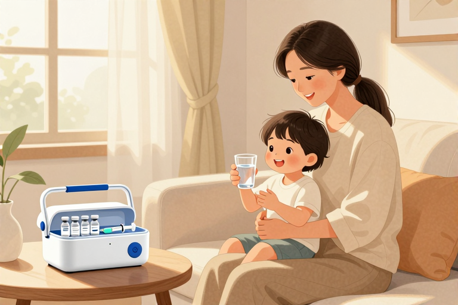

# 打完疫苗吃益生菌

带刚满周岁的宝宝打完疫苗回家，看着针眼消失，家长心里那块石头还没落地。这时候如果宝宝闹脾气要喝酸奶，或者你正打算给肠胃娇嫩的娃补点益生菌，心里肯定会打鼓：这会不会影响疫苗效果？会不会让反应更剧烈？其实，医学界对“打完疫苗吃益生菌”这一具体行为，并没有特殊的禁令或强制推荐。疫苗激发的是特异性免疫，而益生菌调理的是肠道微生态，两者在人体内并行不悖，互不干扰。只要宝宝精神状态尚可，没有严重的急性肠胃炎症状，日常饮食中的发酵乳制品或常规益生菌补充，通常都不会成为阻碍抗体产生的绊脚石。

## 打完疫苗能喝酸奶吗

可以喝。对于大多数接种完疫苗的婴幼儿来说，适量饮用无糖或低糖的酸奶，不仅安全，还能提供优质的蛋白质和钙质。酸奶中的乳酸菌在到达肠道前，大部分会被胃酸杀灭，只有部分活性菌或其代谢产物能发挥调节作用。疫苗进入人体后，免疫系统开始识别抗原并产生抗体，这个过程主要发生在血液和淋巴系统中，与消化道内的菌群环境没有直接的物理接触或化学冲突。因此，喝酸奶不会“冲掉”疫苗，也不会“中和”抗体。

不过，这里有一个细节需要注意：如果你给宝宝喝的是含有大量添加剂的常温酸奶，或者宝宝平时对乳糖不耐受，那么接种后肠胃可能会因为疲劳或轻微应激而变得敏感。这时候，突然摄入高糖或难以消化的乳制品，可能会引起腹胀或腹泻，但这与疫苗本身无关，而是食物耐受性问题。建议首选冷藏型活性乳酸菌饮料，且温度要适宜，避免过冷刺激肠胃。如果宝宝刚打完针就哭闹不止，先安抚情绪，等呼吸平稳后再喂食，以免呛咳引发不适。

- 选择无糖或低糖酸奶，避免高糖加重肠胃负担

- 确保酸奶新鲜且在保质期内，避免细菌污染

- 若宝宝平时喝酸奶正常，接种后也可照常饮用

- 若宝宝有乳糖不耐受史，需选择舒化奶或无乳糖产品

## 益生菌会影响疫苗效果吗

目前没有任何权威医学指南表明，常规剂量的益生菌会削弱或增强疫苗产生的免疫反应。疫苗的核心机制是训练免疫系统识别特定的病原体（如病毒或细菌），而益生菌的作用是维持肠道菌群的平衡，促进局部黏膜免疫。这两套系统虽然都在与“外来物质”打交道，但分工明确。肠道菌群确实参与全身免疫调节，但这种调节是宏观且缓慢的，并不会直接干扰疫苗抗原在体内的特异性识别过程。

有些家长担心益生菌会“激活”免疫系统，导致疫苗副作用加重。这种担忧源于对免疫机制的误解。疫苗的不良反应（如发热、红肿）是免疫系统正常工作的表现，而非益生菌导致的过度反应。相反，对于接种后出现轻微腹泻或便秘的宝宝，适量补充益生菌反而可能有助于缓解肠道症状，让宝宝更舒适地度过观察期。当然，如果宝宝正在服用抗生素，需注意益生菌与抗生素的服用间隔，以免活菌被杀灭，但这与疫苗接种无直接关联。

- 益生菌不干扰疫苗抗原的特异性识别过程

- 常规剂量下不会导致免疫反应过度或不足

- 有助于缓解接种后可能出现的轻微肠胃不适

- 无需为了疫苗效果而刻意停用或加量益生菌

## 接种后肠胃不适怎么办

宝宝打完疫苗后出现吐奶、腹泻或便秘，是常见现象。这通常是因为疫苗刺激了免疫系统，导致身体处于轻微的应激状态，进而影响消化功能；也可能是接种过程中的紧张情绪所致。此时，处理的重点不是纠结于益生菌，而是观察宝宝的整体状态。如果宝宝精神好、能吃能玩，轻微的大便次数增加或性状改变，无需特殊干预，继续正常喂养即可。

若腹泻明显，首要任务是预防脱水。可以口服补液盐III，少量多次喂食。此时，饮食应清淡易消化，如米汤、稀粥，暂停添加新的辅食。如果宝宝之前一直在规律服用益生菌，且耐受良好，可以继续服用，它有助于恢复肠道菌群平衡。但若腹泻严重，伴有黏液或血丝，或宝宝出现精神萎靡、尿量减少，应立即就医，排除其他感染性肠炎的可能。切勿自行使用止泻药，以免掩盖病情。

- 观察宝宝精神状态，若良好则无需过度焦虑

- 轻微腹泻时，优先补充水分和电解质

- 饮食调整为清淡易消化的流质或半流质

- 严重腹泻或精神差时，及时就医排查病因

## 发热期间能吃益生菌吗

如果宝宝接种后出现发热，体温在38.5摄氏度以下，通常建议物理降温，多休息，多饮水。在此状态下，宝宝的消化酶活性降低，胃肠蠕动减慢，食欲减退是正常生理反应。此时，是否服用益生菌，取决于宝宝对补充剂的耐受性。如果宝宝平时吃益生菌没有不良反应，且家长希望维持肠道菌群稳定，可以照常服用，但剂量无需增加。

然而，若宝宝发热伴随呕吐或严重食欲不振，强行喂食任何补充剂都可能引发呛咳或反感。此时，应以补水为主，暂停非必要的口服补充剂，待体温下降、食欲恢复后，再逐步恢复正常饮食和益生菌摄入。切记，益生菌不是退烧药，不能替代对因治疗。若发热持续超过24小时，或体温超过38.5摄氏度且精神不佳，应遵医嘱使用退烧药并排查感染源。

- 低热且精神好时，可照常服用常规剂量益生菌

- 伴随呕吐或拒食时，暂停补充剂以防呛咳

- 益生菌无退烧作用，不能替代对症护理

- 体温持续高企或精神差时，及时就医评估

## 不同疫苗后有区别吗

无论是流感疫苗、新冠疫苗还是常规的儿童计划免疫疫苗，在饮食和肠道菌群干预方面，原则是一致的。目前的研究和数据并未显示某种特定疫苗与益生菌存在特殊的相互作用。因此，家长无需因为接种了不同类型的疫苗而改变对益生菌的使用策略。关键在于宝宝自身的健康状况和既往对益生菌的反应。

对于早产儿、免疫功能低下或患有慢性疾病的宝宝，情况可能稍复杂。这类宝宝的免疫系统更为脆弱，肠道屏障功能也可能不完善。虽然益生菌通常被认为是安全的，但在接种前后是否调整剂量或种类，最好咨询儿科医生或免疫专家的意见。对于健康儿童，保持日常饮食的多样性和均衡性，比刻意通过益生菌来“增强”疫苗效果更为重要和自然。

- 各类疫苗与益生菌的交互作用无特殊差异

- 无需因疫苗类型不同而改变益生菌使用习惯

- 健康儿童保持均衡饮食即可，无需额外强化

- 特殊健康状况宝宝需遵医嘱调整补充方案

## 常见问题

### 宝宝打完疫苗第二天拉肚子正常吗？

可能是疫苗引起的轻微肠道反应，通常1-2天自愈。若精神好可观察，腹泻严重需就医。

### 打完疫苗能马上吃益生菌吗？

可以。益生菌与疫苗无直接冲突，正常服用即可。但建议先观察宝宝状态，若呕吐则暂缓。

### 吃益生菌会影响疫苗抗体产生吗？

不会。目前无证据表明常规益生菌会干扰特异性抗体的生成，两者作用机制不同，互不干扰。

### 宝宝打完疫苗发烧能吃益生菌吗？

低热且食欲正常可吃。若伴随呕吐或拒食，建议暂停以防呛咳，待症状缓解后再恢复服用。

### 早产儿打完疫苗能吃益生菌吗？

需遵医嘱。早产儿肠道和免疫系统较脆弱，是否调整益生菌种类或剂量，应由专业医生评估决定。

⚠️ 温馨提示：本文仅作育儿知识科普，不能替代专业医生的诊断与治疗。宝宝如出现发热、腹泻、精神差等异常情况，请及时就医。

---

原文：[打完疫苗吃益生菌](https://zlaiw.com/10701.html)
