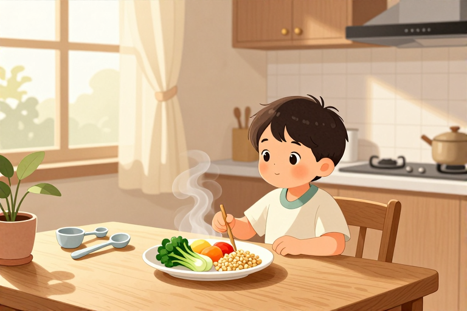

# 鸡蛋过敏什么时候能吃

很多妈妈看着宝宝因为一口鸡蛋就红肿起疹，心里既着急又困惑：这口营养丰富的食物，到底要让孩子躲到几岁？事实是，绝大多数孩子并不会终身与鸡蛋绝缘。医学数据显示，大约三分之二的鸡蛋过敏儿童会在5岁之前自然产生耐受性，重新拥抱这份美味。但这并非坐等奇迹的过程，而是需要家长精准判断时机、科学介入管理的系统工程。盲目等待可能错失最佳脱敏窗口，过早尝试又可能引发危险。我们需要在“安全”与“营养”之间找到那条细细的钢丝，用科学的方法帮孩子跨过这道坎。

## 宝宝多大可以开始尝试鸡蛋

对于没有过敏史的普通宝宝，通常建议在6个月左右添加辅食时引入蛋黄，随后逐步过渡到全蛋。但对于已经确诊或疑似鸡蛋过敏的宝宝，这个时间表需要大幅推迟，且必须遵循“先检测、后尝试”的铁律。过敏体质宝宝的免疫系统处于高度警觉状态，肠道屏障功能相对较弱，过早引入高致敏原食物极易诱发严重的IgE介导型超敏反应。

- 首先确认诊断：不要仅凭肉眼观察皮疹就断定是鸡蛋过敏。皮肤点刺试验或血液特异性IgE检测能提供更客观的依据，阳性结果虽不绝对代表临床过敏，但能指导后续风险等级评估。

- 严格回避期：在医生未明确允许前，应完全回避鸡蛋及含蛋食品，包括蛋糕、饼干等烘焙制品，因为其中的蛋清蛋白即使经过高温也难以完全破坏致敏性。

- 引入时机：通常建议在宝宝满1岁后，若症状控制良好，经医生评估可考虑尝试。部分严重过敏患儿可能需要推迟至2-3岁，具体视个体耐受程度而定。

## 家庭脱敏能自己在家做吗

绝对不行。家庭环境无法模拟医疗级的过敏原暴露控制，自行喂食极易导致过敏性休克等危及生命的急症。鸡蛋过敏的“脱敏”并非简单的“多吃点就习惯了”，而是一个严谨的免疫调节过程。对于部分轻度过敏患儿，医生可能会推荐口服免疫疗法（OIT），即在严密监控下，从极微量的蛋粉开始，逐步增加剂量，让免疫系统逐渐适应。

- 医疗监护是前提：脱敏过程必须在具备急救条件的医疗机构进行。一旦反应过度，需立即注射肾上腺素。家庭环境缺乏自动注射器和急救药品，风险不可控。

- 剂量精确控制：医疗脱敏使用的通常是经过特殊处理的蛋粉，剂量以毫克计，误差极小。家中煮熟的鸡蛋无法提供这种精确的梯度剂量，且烹饪方式会改变蛋白结构，导致反应不可预测。

- 长期维持策略：即使成功脱敏，也需长期维持摄入量以防止耐受性丧失。这需要在营养师指导下制定饮食计划，确保营养均衡，避免因过度限制导致蛋白质摄入不足。

## 出现哪些信号必须就医

判断是否该就医，关键看反应的速度和严重程度。I型超敏反应通常在接触过敏原后几分钟到两小时内发作，表现为速发型症状。若宝宝在进食鸡蛋或含蛋食物后出现以下情况，需立即启动急救并送医。

- 呼吸道症状：声音嘶哑、犬吠样咳嗽、呼吸困难、喘息或喉头水肿感。这是最危险的信号，可能迅速导致气道阻塞。

- 皮肤黏膜反应：全身性荨麻疹（风团）、面部或嘴唇肿胀、眼结膜充血。若皮疹迅速蔓延至全身，提示过敏反应剧烈。

- 消化道及全身症状：频繁呕吐、腹痛、腹泻，伴随精神萎靡、面色苍白、血压下降。严重者可发展为过敏性休克，表现为意识模糊甚至昏迷。

## 鸡蛋过敏会影响其他食物吗

鸡蛋过敏常与牛奶过敏并发，约10%的牛奶蛋白过敏儿童也会对牛肉产生反应，但这并不意味着对所有食物都过敏。交叉反应主要取决于过敏原蛋白的结构相似性。例如，对禽类蛋清过敏者，可能对鸡肉也敏感，但并非绝对。了解这些关联有助于家长在回避鸡蛋的同时，合理拓展其他蛋白质来源。

- 交叉反应筛查：若宝宝对鸡蛋严重过敏，建议同时检测牛奶、小麦等常见过敏原。约60%的牛奶蛋白反应由IgE介导，若确诊，需同步管理乳制品摄入。

- 替代营养方案：回避鸡蛋期间，需通过肉类、鱼类、豆类及坚果（若不过敏）补充优质蛋白和胆碱。蛋黄富含卵磷脂，对大脑发育重要，可通过其他食物如大豆制品替代。

- 定期复查更新：过敏状态是动态变化的。随着肠道屏障成熟和免疫系统发育，部分患儿对其他食物的耐受性也会改变。建议每6-12个月复查一次过敏原谱，及时调整饮食结构。

## 五岁后仍过敏怎么办

虽然三分之二患儿在5岁前脱敏，但仍有少数孩子过敏持续存在。对于大龄儿童或成人鸡蛋过敏者，重点在于风险管理与生活质量平衡。现代医学虽无根治手段，但通过规范治疗和生活方式调整，完全可以实现正常生活。

- 严格标签阅读：加工食品中常含“卵白蛋白”、“卵磷脂”等隐性蛋成分。学会识别配料表中的警示标识，避免误食。

- 应急准备：对于有严重过敏史者，随身携带肾上腺素自动注射器，并确保家人、学校老师掌握使用方法。制定书面急救计划，明确不同症状的应对步骤。

- 心理支持：避免因过度限制导致孩子产生饮食焦虑或社交障碍。通过科普教育让孩子理解自身状况，鼓励其参与适度社交活动，建立自信。

## 常见问题

### 宝宝对鸡蛋过敏还能吃鸡肉吗？

不一定。部分对禽类蛋清蛋白过敏的儿童，可能对鸡肉也产生交叉反应。建议先进行皮肤点刺或血液检测确认，若阳性则需回避鸡肉；若阴性，可在医生指导下少量尝试。

### 鸡蛋过敏宝宝多大能自然脱敏？

约三分之二的鸡蛋过敏儿童在5岁前会产生耐受。但这并非必然，个体差异巨大。建议定期复查过敏原特异性IgE水平，由医生评估是否具备尝试条件，切勿盲目等待。

### 鸡蛋过敏必须完全不吃蛋吗？

在确诊且未脱敏前，需严格回避。但可通过肉类、豆类、坚果补充营养。若经医疗脱敏治疗成功，可在医生指导下逐步 （重新引入），恢复饮食多样性。

### 鸡蛋过敏会导致其他食物过敏吗？

可能并发。约10%牛奶蛋白过敏儿童对牛肉也敏感。建议同时筛查常见过敏原。过敏状态动态变化，定期复查可及时调整饮食，避免不必要的过度限制或风险暴露。

### 鸡蛋过敏宝宝可以打疫苗吗？

多数疫苗不含鸡蛋成分，可正常接种。但部分流感疫苗或黄热病疫苗可能含微量卵白蛋白。接种前务必告知医生过敏史，由专业医师评估风险，必要时在医疗监护下接种。

⚠️ 温馨提示：本文仅作育儿知识科普，不能替代专业医生的诊断与治疗。宝宝如出现发热、腹泻、精神差等异常情况，请及时就医。

---

原文：[鸡蛋过敏什么时候能吃](https://zlaiw.com/10640.html)
