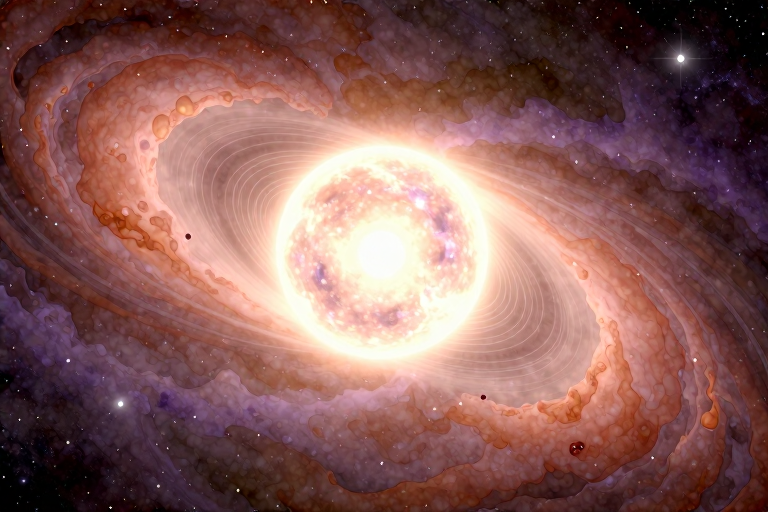

# 中子星肉眼能看到吗

答案是肯定的，你无法用肉眼直接观测到中子星。尽管它们是宇宙中密度最大、引力最强的天体之一，表面温度高达60万开尔文，但由于距离地球极其遥远且自身发光微弱，它们对人类的眼睛来说就像黑暗海洋中的微尘。要“看见”它们，人类必须借助射电望远镜捕捉其发出的无线电波，或者通过X射线天文台观测其高能辐射。

## 中子星为什么看不见

看不见中子星，最根本的原因在于“距离”与“亮度”的残酷博弈。中子星通常位于银河系深处，距离地球往往以光年甚至数千光年计。即便它们表面温度极高，辐射出巨大的能量，这些能量在漫长的星际旅行中也会因扩散而变得极其稀薄。想象一下，你在几公里外看一个小小的萤火虫，虽然它确实在发光，但你的眼睛很难捕捉到那点微光。中子星就像是一个被扔进黑暗大海的微小灯泡，虽然内部核聚变或引力坍缩释放的能量巨大，但到达地球时，其可见光强度已远低于人眼的感知阈值。

此外，中子星的体积非常小。典型的半径仅在10至20公里之间，这大概相当于一座特大城市的直径。相比之下，太阳的半径约为69万公里。这样小的发光体，即便亮度极高，其总的光度也远不如恒星。对于肉眼而言，我们需要天体具有一定的视面积和足够的亮度才能形成视觉信号。中子星在天空中只是一个点，甚至是一个无法被点亮的暗点，因此它无法像月亮或亮星那样直接映入我们的眼帘。

还有一个关键因素是电磁波谱的限制。人眼只能感知波长在380纳米到750纳米之间的可见光。然而，许多中子星，特别是脉冲星，其主要能量辐射并不集中在可见光波段。它们更像是一台强力的高频无线电发射塔，将大部分能量以射电波、X射线或伽马射线的形式释放出去。这些波段超出了人眼的生理极限，就像蝙蝠的回声导航对人类来说不可见一样，中子星的“主要声音”我们也听不见、看不见。

## 如何发现这些隐形天体

既然肉眼无法捕捉，天文学家是如何在浩瀚星空中定位这些“隐形人”的呢？主要依靠探测其发出的非可见光辐射，尤其是射电波和X射线。1967年，乔丝琳·贝尔首次通过射电望远镜记录到规律的无线电脉冲信号，这成为了人类发现第一颗脉冲星（即旋转的中子星）的里程碑。这种信号并非来自恒星表面的闪烁，而是源于中子星强大的磁场和快速自转。

中子星拥有极强的磁场，磁星磁场强度可达10^11特斯拉。当带电粒子沿着磁力线高速运动时，会发出强烈的同步辐射，其中就包括射电波。这些射电波像灯塔的光束一样，随着中子星的旋转扫过地球。如果中子星的自转轴与视线方向合适，我们就会接收到周期性的脉冲信号，就像在黑暗中看到了规律闪烁的灯塔。这种“灯塔效应”使得即使看不见星体本身，也能通过其辐射特征确认其存在。

除了射电波段，X射线也是探测中子星的重要手段。当双星系统中的中子星从伴星恒星吸积物质时，这些物质在落入中子星表面的过程中会释放巨大的引力势能，转化为高温并辐射出强烈的X射线。1971年发现的半人马座X-3就是第一颗被证认的X射线双星，其中包含一颗炙热的中子星。通过X射线天文台，我们可以“看”到这些正在吞噬伴星物质的黑暗天体。

## 中子星的极端物理特性

中子星之所以如此特殊，是因为它代表了恒星演化的一种极端终点。当大质量恒星在生命末期发生超新星爆炸后，其核心在引力作用下急剧坍缩。电子被压入原子核，与质子结合形成中子，从而产生“中子简并压力”来抗衡引力。这种物质状态在地球实验室中无法复现，其密度高达每立方厘米8×10^7吨至2×10^9吨。

为了理解这个密度，我们可以做一个类比：如果将一茶匙的中子星物质带到地球，它将重达数亿吨。这种极端的密度导致了极其强大的表面重力，是地球的2×10^11到3×10^12倍。在这样的重力环境下，逃逸速度高达10,000至150,000公里/秒，接近光速的半数。这意味着，任何物质一旦靠近中子星，都将被其强大的引力牢牢捕获，并以极高的速度撞击表面，释放出惊人的能量。

中子星的自转速度也令人咋舌。毫秒脉冲星的自转周期可短至700分之一秒，这意味着它每秒要旋转超过1000圈。这种快速自转不仅产生了强大的磁场变化，还导致了其辐射束的周期性扫过。相比之下，普通恒星如太阳的自转周期约为25天。中子星的快速自转和强磁场共同作用，使其成为宇宙中最活跃的“能量引擎”之一。

## 中子星与人类生活的距离

虽然中子星听起来遥远而神秘，但它们其实就在我们的银河系内。据估计，银河系内至少存在20万颗中子星。截至2023年8月，人类已发现超过3000颗脉冲星。其中一些距离地球相对较近，例如RX J1856.5-3754被认为是最近的中子星之一，但即便如此，它距离我们也有数百光年之遥。

对于生活在地球上的我们来说，这些天体目前没有任何直接的物理威胁。它们虽然质量巨大，但距离太远，其引力影响在星际尺度上可以忽略不计。然而，研究它们对理解宇宙的基本物理规律至关重要。中子星是自然界中唯一能提供极端密度、强磁场和强引力环境的“实验室”，帮助科学家检验广义相对论、核物质状态方程等基础理论。

未来，随着观测技术的进步，我们可能会发现更多靠近地球的中子星，或者通过引力波探测到双中子星合并的事件。这些事件会产生引力波，虽然目前无法被肉眼感知，但通过精密仪器可以捕捉到时空的微小涟漪。中子星的研究不仅拓展了人类的认知边界，也提醒我们，宇宙中充满了超越日常经验的奇迹与奥秘。

## 为什么脉冲星能像时钟一样准

脉冲星之所以能像原子钟一样精准，源于其物理结构的极度稳定。中子星质量巨大、体积微小，这意味着它具有极高的转动惯量稳定性。根据角动量守恒定律，一个旋转物体在没有外力矩作用下，其旋转速度将保持不变。中子星在真空中自转，受到的阻力极小，因此其自转周期极其稳定。

毫秒脉冲星的稳定性甚至优于某些原子钟。这是因为它们通常处于双星系统中，通过吸积伴星物质加速自转，达到极高的转速。这种高速旋转使得任何微小的形状不规则都会被“甩平”，从而进一步提高了结构的对称性和稳定性。天文学家利用这种稳定性，可以精确测量时间，甚至用于导航和检验引力理论。

然而，脉冲星的周期性并非绝对完美。中子星内部的地震、磁层活动或吸积过程的变化，都可能导致自转速度的微小波动，称为“脉冲计时残差”。通过分析这些残差，科学家可以反推中子星的内部结构、磁场变化甚至探测引力波背景。这种“宇宙时钟”的精度，是人类目前最精密的时间标准之一。

## 常见问题

### 中子星的表面温度有多高？

已观测到的中子星表面温度通常约为60万开尔文。这个温度远高于太阳表面，但由于其体积小、距离远，我们只能通过仪器感知其辐射而非肉眼看到高温发光。

### 中子星的密度到底有多大？

中子星的密度约等于原子核的密度，每立方厘米可达8×10^7吨至2×10^9吨。这意味着一茶匙的中子星物质在地球上将重达数亿吨，是宇宙中最致密的天体之一。

### 什么是脉冲星和中子星的关系？

脉冲星就是快速旋转并辐射电磁波束的中子星。1967年发现的规律无线电脉冲被确认为中子星发出。简而言之，脉冲星是中子星的一种观测表现形态，特别是当它的辐射束扫过地球时。

### 中子星会威胁到地球安全吗？

目前已知最近的中子星也距离地球数百光年，其引力影响在星际尺度上可忽略不计。虽然它们能量巨大，但距离太远，不会对地球构成直接物理威胁，是安全的科研对象。

### 人类是如何首次发现中子星的？

1967年，乔丝琳·贝尔通过射电望远镜发现了规律的无线电脉冲信号，确认为中子星发出。此前，1934年巴德和兹威基曾预言中子星存在，但直到脉冲星的发现才证实了这一理论。

---

原文：[中子星肉眼能看到吗](https://zlaiw.com/10637.html)
