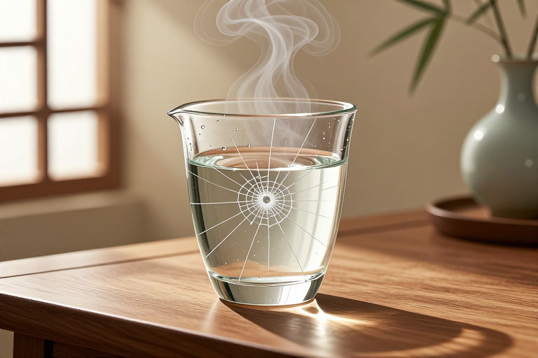

# 厚玻璃杯遇热水炸裂是什么原理

你大概有过这样的经历：刚倒进一壶滚烫的开水，只听“啪”的一声脆响，手里的厚玻璃杯瞬间裂开，甚至炸成碎片。这并非杯子质量不好，而是物理定律在起作用。玻璃是一种热的不良导体，导热速度极慢，当热水接触内壁时，内壁迅速受热膨胀，而外壁还保持着低温状态，这种内外膨胀的步调不一致，在玻璃内部撕扯出巨大的应力，最终超过了材料承受的极限，杯子便“粉身碎骨”了。

## 为什么厚杯子比薄杯子更容易裂

厚玻璃杯之所以成为“炸裂重灾区”，核心在于其壁厚带来的热传导滞后。当你将沸水注入杯中，热量需要从内壁传递到外壁。对于薄壁玻璃，这个距离很短，热量能较快均衡，内外温差小，产生的应力也微弱。但厚玻璃杯的壁厚往往达到几毫米甚至更厚，这层厚厚的玻璃像一道隔热墙，阻断了热量的快速扩散。

想象一下，内壁的玻璃分子在热水的加热下，像被催熟的果实一样拼命向外扩张，试图占据更大的空间。然而，紧邻的外壁玻璃还沉浸在之前的低温中，分子排列紧凑，纹丝不动。内壁想往外跑，外壁却死死拽住它不放，这种“拉扯”在玻璃内部形成了巨大的张应力和压应力。玻璃作为一种非晶体固体，虽然坚硬，但非常脆，缺乏金属那样的延展性来释放这些应力。当应力累积超过玻璃分子键的承受极限时，裂缝就会从表面最脆弱的缺陷处开始，瞬间贯穿整个杯体。壁厚越大，温差积累越显著，炸裂的风险就呈指数级上升。

## 普通玻璃和高硼硅玻璃有什么区别

并非所有玻璃都这么“娇气”，市面上常见的耐热玻璃杯通常由高硼硅玻璃制成，这与普通钠钙玻璃有着本质的区别。普通玻璃，也就是我们日常见到的窗户玻璃或廉价水杯材料，主要成分是二氧化硅、氧化钠和氧化钙。这类玻璃的热膨胀系数较高，意味着它对环境温度变化非常敏感。稍微一点温差，它就会产生明显的体积变化。

相比之下，高硼硅玻璃在制造过程中加入了氧化硼。这种特殊的成分极大地降低了玻璃的热膨胀系数。简单来说，高硼硅玻璃对温度变化的“敏感度”低得多，受热时膨胀幅度小，遇冷时收缩也慢。因此，即使内外壁存在温差，其产生的内部应力也远小于普通玻璃，不足以破坏其结构。这就是为什么标榜“耐热”的玻璃杯敢直接承受开水冲泡，而普通厚玻璃杯却不敢的原因。如果你经常需要喝热水或泡茶，选择高硼硅玻璃是避免炸裂的最有效手段。

## 玻璃炸裂前有什么征兆能察觉吗

大多数时候，玻璃杯的炸裂是突发性的，没有任何预兆。但在某些特定条件下，如果你仔细观察，或许能捕捉到一些细微的迹象。首先是声音。在炸裂前的瞬间，你可能会听到轻微的“噼啪”声或“咔咔”声。这是玻璃内部微裂纹扩展时释放能量的声音，也是应力正在累积的信号。如果听到这种声音，应立即停止加热或倒水，让杯子自然冷却。

其次是视觉上的细微变化。虽然肉眼很难直接看到内部的应力分布，但如果你透过光线观察杯壁，可能会发现某些区域出现了模糊的彩虹色条纹。这是因为玻璃内部应力导致的光学双折射现象。应力越大的地方，条纹越明显。此外，如果杯子之前已经有过微小的磕碰或划痕，这些缺陷处会成为应力集中的焦点。在受热时，你可以看到裂纹尖端有极其细微的变化，或者杯口边缘出现不规则的崩缺。这些都是玻璃即将失效的警告。虽然这些征兆难以察觉，但了解它们有助于我们在日常使用中更加谨慎，特别是在处理旧杯子或已知有瑕疵的杯子时。

## 如何正确使用厚玻璃杯避免炸裂

想要安全地使用厚玻璃杯，关键在于控制温度变化的速率，给热量传递留出足够的时间。以下是一些经过验证的安全操作建议：

- **预热杯子**：在倒入热水前，先用温水冲洗杯壁内外，或者装入少量温水摇晃几秒后倒掉。这一步能让杯体整体温度略微升高，缩小与后续倒入热水的温差。

- **缓慢注水**：不要一下子将开水猛灌入杯中。可以先倒入少量热水，轻轻摇晃使杯壁均匀受热，然后再慢慢加满。这样可以让热量有足够的时间从内壁传导至外壁，减小温差梯度。

- **避免极端温差**：尽量不要将刚从冰箱冷藏室取出的玻璃杯直接倒入沸水。如果必须这样做，请先让杯子在室温下放置一段时间，或者先用常温水过渡。同样，刚倒过开水的杯子，也不要立即放入冷水中冲洗，应待其自然冷却至室温。

- **检查瑕疵**：每次使用前，仔细检查杯身是否有细微裂纹、缺口或划痕。这些缺陷是应力集中的“突破口”，极易引发炸裂。一旦发现瑕疵，应立即停止使用并更换。

## 玻璃炸裂后的碎片如何处理才安全

如果不幸发生炸裂，处理碎片时的安全性至关重要。玻璃碎片往往细小且锋利，直接用手捡拾极易划伤手指。正确的处理方式需要耐心和细致的工具。首先，不要试图用湿抹布直接擦拭，因为水可能会让碎片更加分散，甚至滑入缝隙难以清理。

建议按以下步骤操作：

- **佩戴防护**：戴上厚实的橡胶手套或皮革手套，防止意外划伤。

- **大块回收**：用扫帚和簸箕将较大的碎片扫入垃圾袋中。注意不要用力碾压，以免产生更细的碎屑。

- **细小清理**：对于残留的微小碎片，可以使用宽胶带、湿纸巾或面包片（利用其粘性吸附）进行清理。特别是在地毯或织物表面，轻轻按压胶带可有效粘起细小玻璃渣。

- **妥善丢弃**：将收集到的玻璃碎片装入坚硬的纸箱或厚塑料袋中，并用胶带封好，标注“内有碎玻璃”，以防清洁人员受伤。切勿直接丢入普通垃圾桶而不做保护。

厚玻璃杯的炸裂，本质上是热胀冷缩这一物理现象在材料特性限制下的必然结果。玻璃导热慢、脆性大，使得它在面对剧烈温差时显得尤为脆弱。理解这一点，我们就能明白为何“预热”和“缓注”如此重要。选择高硼硅玻璃材质、避免骤冷骤热、定期检查杯体完整性，是保护双手和延长杯子寿命的关键。下次当你端起一杯热茶时，不妨多一分耐心，让热量温柔地渗透每一寸玻璃，享受温暖的同时，也守住安全的底线。

## 常见问题

### 为什么薄玻璃杯不容易炸裂而厚玻璃杯容易？

薄玻璃杯壁厚小，热量能快速从内壁传导至外壁，内外温差小，产生的应力不足以破坏结构。厚玻璃杯导热慢，内外温差大，应力集中导致炸裂。

### 高硼硅玻璃和普通玻璃耐热性差别有多大？

高硼硅玻璃热膨胀系数极低，耐热冲击性强，可直接承受开水冲泡。普通钠钙玻璃热膨胀系数高，遇剧烈温差易炸裂，耐热性差很多。

### 玻璃杯炸裂前会有声音或征兆吗？

可能有。炸裂前常伴随轻微的“噼啪”声，这是内部微裂纹扩展的声音。有时透过光线能看到杯壁出现彩虹色条纹，这是应力集中的光学表现。

### 从冰箱拿出的玻璃杯能直接倒开水吗？

不能。低温玻璃突然接触高温水，内外温差极大，极易炸裂。应先让杯子回温，或先用温水预热，再缓慢倒入热水，避免温度骤变。

### 玻璃杯炸裂后的碎片怎么清理最安全？

戴手套用扫帚清理大块碎片。细小碎片可用宽胶带粘取或湿纸巾擦拭。清理后装入硬盒或厚袋封好，标注“内有碎玻璃”，防止伤人。

---

原文：[厚玻璃杯遇热水炸裂是什么原理](https://zlaiw.com/10606.html)
