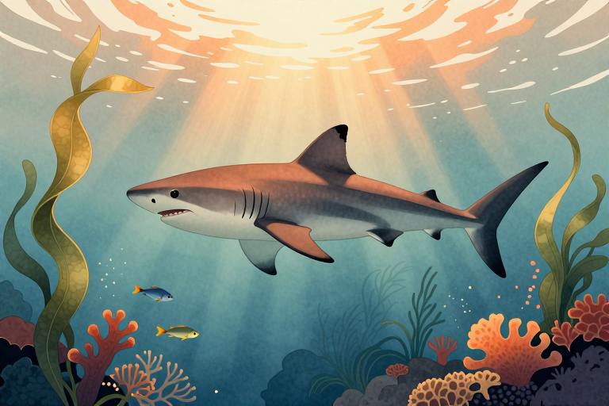

# 鲨鱼到底是不是鱼类

当我们谈论“鱼”时，脑海里浮现的往往是银鳞闪烁、吐着泡泡的金鱼，或是红烧后鲜美的海鱼。但如果你问一条鲨鱼是不是鱼，答案会让人感到意外：它确实是鱼，而且是一种比恐龙还要古老的鱼。早在约4.5亿年前的奥陶纪晚期，鲨鱼的祖先就已经在海洋中巡游，比陆地上的恐龙早了数亿年。它们不是哺乳动物，也不是爬行动物，而是软骨鱼纲板鳃亚纲下的成员。理解这一点，能让我们重新审视这些游弋在深海的古老猎手。

## 为什么鲨鱼没有硬骨头

鲨鱼确实是鱼类，但它们与我们熟悉的硬骨鱼有着本质的区别：全身骨骼由软骨组成，没有硬骨。这意味着当你触摸鲨鱼皮肤时，感受到的不是坚硬的脊背，而是富有弹性的支撑结构。这种软骨结构不仅减轻了体重，还赋予了它们极高的灵活性。为了弥补软骨强度不足的缺陷，鲨鱼皮肤表面覆盖着一层微小的盾鳞，这些六角形板阵由钙盐结晶块组合而成，像马赛克一样排列，既保护身体免受寄生虫侵扰，又降低了水流阻力，让它们在游动时更加迅捷。

此外，鲨鱼没有硬骨鱼那样的鳔来调节浮力。它们依靠巨大的肝脏中储存的油脂来维持平衡，这层油脂在零下50摄氏度也不会冻结，且含油率可高达63%。这种独特的生理构造让鲨鱼成为海洋中高效的猎手，但也意味着它们必须时刻游动，否则就会沉入海底。

## 鲨鱼如何呼吸与感知世界

大多数鱼类拥有鳃盖，通过肌肉泵水让水流过鳃部进行气体交换。鲨鱼则不同，它们的头部两侧有5到7个鳃裂，没有鳃盖保护。这导致了一个关键后果：鲨鱼必须不断游动，迫使海水冲过鳃裂才能呼吸。一旦停止游动，它们就会窒息。这也是为什么我们在纪录片中看到的鲨鱼总是永不停歇地穿梭于深海之中。

除了独特的呼吸方式，鲨鱼还拥有一套令人惊叹的感官系统。它们头部前方分布着特殊的感应器，称为劳伦氏壶腹，能够探测到猎物肌肉收缩时产生的微弱电信号。这意味着即使猎物藏在沙底或完全静止，鲨鱼也能精准定位。同时，它们的嗅觉极其灵敏，能嗅出几公里外鱼类释放的血腥味。这种全方位的感知网络，让鲨鱼在浑浊的海水中也能成为顶级的掠食者。

## 鲨鱼牙齿为何永远换不完

如果你曾见过鲨鱼的口腔，会被其恐怖而精密的牙齿排列所震撼。鲨鱼的牙齿并非像人类一样固定在牙槽中，而是嵌在牙龈组织里，像传送带一样层层叠放。当最外层的牙齿磨损或脱落时，内部的牙齿会迅速向前移动补充。这种替换机制极其高效，部分鲨鱼一生中可以替换超过3万颗牙齿。

不同食性的鲨鱼，牙齿形态也截然不同。以软体动物为食的鲨鱼拥有扁平的板状齿，用于碾碎贝壳；以鱼类为食的鲨鱼长着针状尖牙，防止猎物逃脱；而捕食海洋哺乳动物的顶级掠食者，如大白鲨，则拥有锯齿状的上颚，能轻易撕开厚实的皮肉。这种多样化的牙齿设计，展现了鲨鱼在数亿年演化中对不同生态位的完美适应。

## 鲨鱼在海洋中扮演什么角色

作为海洋生态系统中的顶级掠食者，鲨鱼维持着海洋生物链的平衡。它们捕食病弱或年幼的动物，防止某些物种过度繁殖，从而保护珊瑚礁和海草床的健康。然而，过去50年间，由于过度捕捞和鱼翅贸易，全球鲨鱼和鳐鱼的数量下降了71%。这一严峻的现实提醒我们，鲨鱼的生存状况直接关联着整个海洋生态系统的健康。

尽管形象凶猛，许多鲨鱼种类其实性情温和。鲸鲨和姥鲨作为最大的鲨鱼种类，主要以滤食浮游生物为生，与人类并无冲突。近年来，帕劳等地建立了鲨鱼保护区，各国也加强了对鲨鱼贸易的监管。了解鲨鱼的真实习性，摒弃恐惧，转而关注其生态价值，是我们保护这些古老生命的第一步。

## 如何正确看待鲨鱼与人类的关系

在流行文化中，鲨鱼常被描绘为嗜血的怪物，但事实并非如此。绝大多数鲨鱼攻击人类的事件极为罕见，且多发生在混淆目标或自卫的情况下。冲浪者在水中挥动的肢体可能被鲨鱼误认为海豹，但这并不意味着鲨鱼主动猎杀人类。相反，许多太平洋岛国的原住民将鲨鱼视为祖先的守护者，对其充满敬畏。

面对鲨鱼，科学的态度是尊重与防范。避免在黎明或黄昏等鲨鱼活跃时段游泳，不在海中清洗鱼类，以及穿着颜色鲜艳的潜水服以减少被误认的概率，都是有效的预防措施。与其恐惧，不如了解。当我们认识到鲨鱼是海洋健康的指示物种时，保护它们就是保护我们赖以生存的蓝色星球。

## 常见问题

### 鲨鱼是哺乳动物还是鱼类？

鲨鱼是鱼类，属于软骨鱼纲。它们用鳃呼吸，通过产卵或胎生繁殖，而非像鲸鱼那样用肺呼吸和哺乳幼崽。

### 鲨鱼为什么必须一直游动？

因为鲨鱼没有鳔，且依靠水流过鳃部呼吸。如果不持续游动，它们既会沉底也会窒息，这是其独特的生理结构决定的。

### 鲨鱼牙齿掉了还能长出来吗？

能。鲨鱼牙齿嵌在牙龈中呈传送带式排列，旧牙脱落后面部的牙齿会迅速前移补充，一生可替换数万颗牙齿。

### 鲨鱼能感知到远处的血腥味吗？

可以。鲨鱼的嗅觉极其灵敏，能探测到几公里外血液稀释后的气味分子，这帮助它们在广阔海洋中定位猎物。

### 所有鲨鱼都吃人吗？

不是。大多数鲨鱼以鱼类或无脊椎动物为食，如鲸鲨和姥鲨主要滤食浮游生物。攻击人类的事件在鲨鱼群体中占比极低。

---

原文：[鲨鱼到底是不是鱼类](https://zlaiw.com/10698.html)
